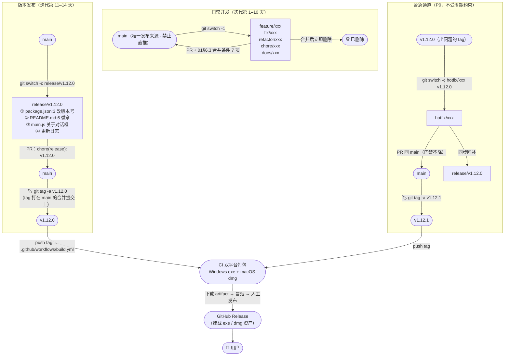
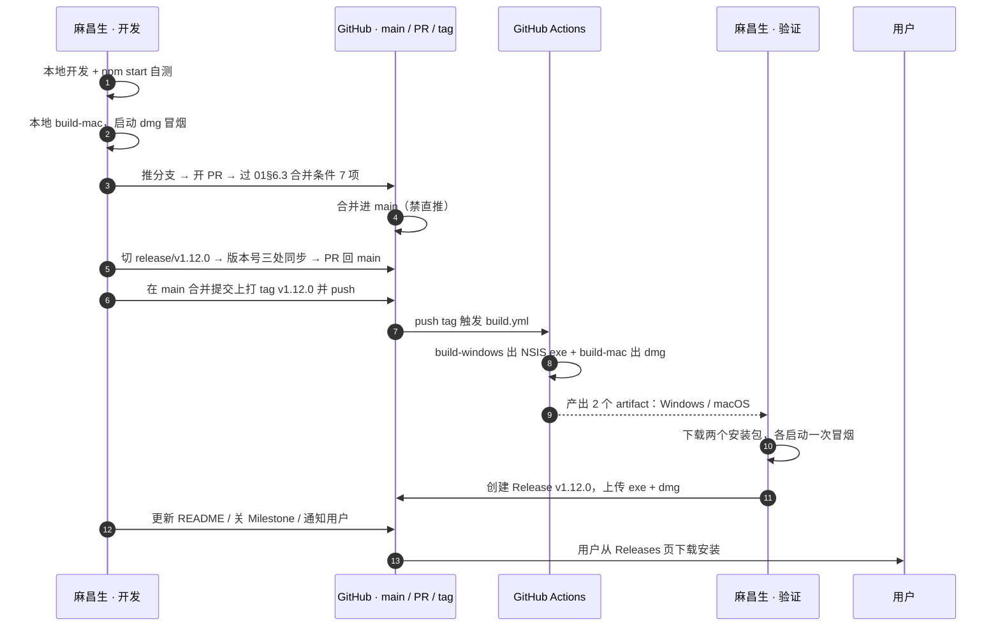
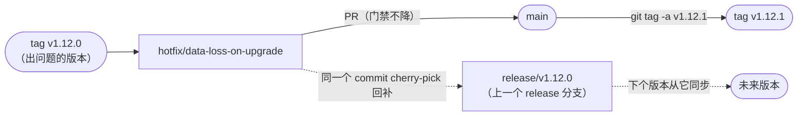
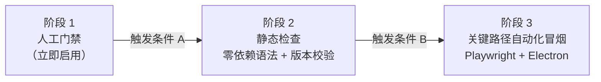

# 写作面板系统 · 交付流程与版本发布

| 项目 | 内容 |
|------|------|
| 项目名 | 写作面板系统 WritingPanelSystem |
| 仓库 | `github.com/likeweixue/Writingpanelsystem` |
| 适用范围 | **仅本仓库**。Electron 28 + electron-builder 24，纯 HTML/CSS/原生 JS，**无构建步骤**的桌面写作软件 |
| 文档版本 | **v1.2**（v1.0 初版 → v1.1 采纳 QA 交叉核对意见 → v1.2 承接 01 v1.1 的强制 review 扩项，见文末修订记录） |
| 生效日期 | 2026-10-03 |
| Owner | 麻昌生（主力开发 · 兼任 Release Manager） |
| 适用规模 | 1–3 人小团队（当前实际：麻昌生 1 人主力 + likeweixue 协作） |
| 上游文档 | `docs/01-团队协作规范.md`（分支命名、提交格式、版本号真源、迭代节奏、两张 checklist 一律沿用，本文档不重复定义） |
| 下游文档 | `docs/03-质量门禁与验收标准.md`（QA 严过关） |

> **本文档的边界**：只定"代码怎么变成用户手里的安装包"的流程与规则。
> **所有 CI/流水线内容一律以「章节 + 命令 / 步骤描述」形式给出，不在本文档之外落地任何 yml 文件、不新建脚本、不修改 `.github/`。**
> 需要落地时，由 Owner 另开一个 `chore/` 分支单独实施，实施内容以本文档的描述为准。

---

## 0. 前置约定与现实约束（设计前提）

> **一句话结论**：本项目 95% 的严重问题只在**打包态**暴露，因此交付流程的重心不是"自动化跑得多快"，而是"**每个版本都必须有人真的把安装包打开点一遍**"。

### 0.1 从上游文档继承的约定（不重新定义）

| 约定 | 出处 | 本文档如何沿用 |
|------|------|--------------|
| 分支命名 `<type>/<小写英文slug>`，type ∈ feature/fix/hotfix/refactor/chore/docs/release | 01 §4.2 | 第 1 章直接作图，不改命名 |
| `main` 是唯一发布来源、禁止直推、只能经 PR 合并 | 01 §4.1 | 第 1 章所有箭头最终都汇入 `main` |
| 提交格式 `<type>(<scope>): <subject>`，破坏性变更加 `!` + `BREAKING CHANGE:` | 01 §5 | 第 2 章发版提交沿用 `chore(release): vX.Y.Z` |
| 版本号唯一真源 = `package.json`，值必须合法 semver；tag 格式 `vX.Y.Z` | 01 §8 | 第 4 章展开为可执行步骤 |
| PATCH=修缺陷 / MINOR=新功能 / MAJOR=不兼容变更 | 01 §8.2 | 第 4.1 节表格化 |
| 双周节奏（10 天开发 + 2 天打包验证 + 2 天缓冲） | 01 §2.1 | 第 2 章按此排期 |
| 合并条件 7 项（01 §6.3）、发版同步清单 7 项（01 §8.3） | 01 | 作为第 5 章 Release Checklist 的门禁项直接引用 |

### 0.2 架构师对 01 文档一处冲突的裁决

01 §4.1 写"打 tag 只从 `main` 打"，01 §4.3 写"release 分支上做版本号同步后打 tag"。两者直接冲突，本文档按下述方式统一，**后续以本裁决为准**：

| 裁决 | 内容 |
|------|------|
| `release/vX.Y.Z` 的职责 | **只做"版本号同步 + 更新日志"这块脏活**，是一个临时工作区，不是发布来源 |
| 发布动作 | release 分支经 **PR 合并回 `main`** 后，**在 `main` 的合并提交上打 tag** |
| 效果 | 同时满足"`main` 禁止直推 / 只能经 PR 合并"与"`main` 是唯一发布来源 / tag 只从 main 打" |

### 0.3 不可回避的现实约束（决定了流程长什么样）

| # | 现实 | 证据 | 对流程的硬影响 |
|---|------|------|--------------|
| 1 | **本机是 macOS，Windows 安装包只能靠 CI 产出** | 工作目录 `/Users/...`；`package.json:9` `build-win` | "双平台本地 build 通过"这条**不可能 100% 本地完成** → 必须保留"CI 出包后下载 Windows artifact 冒烟"这一步，且它排在"创建 Release"**之前** |
| 2 | **无 lint、无测试、无类型检查** | 无 eslint/tsc/测试框架 | 阶段 1 只能用人工门禁（第 9 章） |
| 3 | **导出 DOCX 依赖外部 CDN** | `index.html:4` `cdn.jsdelivr.net/npm/docx@8.5.0` | 离线/内网/CDN 故障 → 打包版静默功能缺失，必须进发版检查清单 |
| 4 | **用户数据全在 localStorage，无云备份** | `js/data.js:34/42/68`（`wps_groups`/`wps_trash`/`wps_data`）、`js/notes.js:13`（`openwrite_note_<bookId>`）、`js/timeline.js:13`（`openwrite_timeline_<bookId>`） | **任何回滚都不得删除/迁移用户 localStorage 数据**（第 7 章红线） |
| 5 | **仓库尚未 git 初始化** | 工作目录无 `.git` | 第 2 章第 0 步必须先 `git init` 并推送，否则全流程无法落地 |
| 6 | **打包态缺陷是本项目头号杀手** | `main.js:190` `setWindowOpenHandler` 曾 deny 空 URL 导致"⤢ 放大面板"打包后打不开 | 安装包启动冒烟是**强制门禁**，不可省略 |
| 7 | 已有的**本地文件备份通道** | `main.js:10` `~/Documents/写作面板系统备份/`；`preload.js:5-7` `backupBook` / `backupAllBooks` / `openBackupFolder` | 这是数据事故应急的**唯一兜底手段**，第 7 章应急步骤直接复用 |

---

## 1. 主线分支模型

> **一句话结论**：只有 `main` 一个长期分支；其余全是**短命分支**，`feature/fix/refactor/chore/docs` 一律从 `main` 切出、PR 回 `main`、合并后立即删除；`release/vX.Y.Z` 从 `main` 切出、PR 回 `main`、**tag 打在 main 的合并提交上**；`hotfix/*` 从出问题的 tag 切出、PR 回 `main` 并回补上一个 release 分支。

### 1.1 流向图



### 1.2 分支流向规则表

| 分支类型 | 从哪切出 | 合并回哪 | tag 打在哪 | 合并后处理 | 保护 |
|---------|---------|---------|-----------|-----------|------|
| `feature/` `fix/` `refactor/` `chore/` `docs/` | `main` | `main`（PR） | — | **立即删除** | `main` 禁直推 |
| `release/vX.Y.Z` | `main` | `main`（PR，**唯一例外地合并回 main**） | **在 `main` 的合并提交上** | 保留至下个版本发布后删除 | `main` 禁直推 |
| `hotfix/*` | **出问题的 tag**（不是 main，见第 6 章） | `main`（PR）+ 回补上一个 release 分支 | 在 `main` 的合并提交上 | 发布后删除 | 门禁不降 |
| `main` | — | — | 所有 `v*` tag 的唯一落点 | — | **禁止直接 push，只能经 PR** |

> **为什么 `release/vX.Y.Z` 要合并回 `main` 而不是"不再合并回去"**：因为 `main` 禁直推 + tag 只从 `main` 打。版本号同步这个提交必须先进 `main`，否则 `main` 上的 `package.json` 会和 tag 对应的代码不一致，下一个迭代从 `main` 切分支时版本号又会漂移。

### 1.3 分支生命周期铁律

| 规则 | 要求 |
|------|------|
| 存活时间 | 短分支 ≤ 10 天；超过 10 天的必须说明原因或拆 PR |
| 一分支一目标 | 一个分支只解决一个 Issue（01 §4.4） |
| 切分支前 | 先 `git switch main && git pull --ff-only`，从最新 `main` 切 |
| 合并后 | 当天删除本地与远程分支：`git branch -d <branch>` + `git push origin --delete <branch>` |
| 命名 | `<type>/<小写英文slug>`，长度 ≤ 30 字符，禁止中文/空格/大写（01 §4.2） |

---

## 2. 从代码到用户手里的完整链路

> **一句话结论**：全程 **9 步**，其中**第 3 步（本地打包冒烟）和第 7 步（CI 产物冒烟）是不可省略的强制门禁**——这两步正是本项目历史上唯一能拦住"打包后才暴露的缺陷"的关卡。

### 2.1 链路时序图

> 图中 `autonumber` 的 **1–10 对应下方 2.2 表的步骤 1–10**，第 11 步是用户侧动作。



### 2.2 逐步执行表（执行人 / 产出物 / 失败怎么办）

| # | 步骤 | 执行人 | 产出物 | 判定通过的标准 | **失败怎么办** |
|---|------|-------|-------|--------------|--------------|
| 0 | **仓库初始化（一次性）** | Owner | `.git` + 远程 `origin` | `git log` 有记录；`git remote -v` 指向 `likeweixue/Writingpanelsystem` | 未初始化则后续全部无法执行 → 先做这条，别往下走 |
| 1 | 本地开发 + `npm start` 自测 | 开发 | 可运行的应用 | 改动功能在开发态表现符合 Issue 验收标准 | 回到开发态修；不要推分支 |
| 2 | **本地打包冒烟**（本机 macOS） | 开发 | `dist/WritingPanelSystem-1.12.0.dmg` | **启动安装包**（不是 `npm start`），重点复测：面板窗口 `⤢`、导出 DOCX、导入/导出书籍、主题切换、自定义背景 | 命中 01 §6.2 ③ → 打 `bug:package-only` 标签，回到步骤 1 修，**禁止继续发版** |
| 3 | 推分支 → 开 PR | 开发 | 一个 PR | 描述里勾选 01 §6.3 合并条件 7 项；命中 01 §6.1 高危场景的已有人审 | Reviewer Request changes → 改完重推；48h 无响应按 01 §6.4 由 Owner 自行合并并留"单人合并 + 回滚方案"评论 |
| 4 | 合并进 `main` | Owner / Reviewer | `main` 上的合并提交 | **必须经 PR**，禁止直推 | 误直推 → `git revert` 后重走 PR（第 7.1 节） |
| 5 | 切 `release/vX.Y.Z`，版本号三处同步 | Release Manager | 版本号同步提交 `chore(release): vX.Y.Z` | `package.json:3` / `README.md:6` / `main.js` 关于对话框三处一致（第 4 章） | 版本号不一致 → PR 打回；**版本号不合法的 PR 一律不予合并** |
| 6 | release PR 合并回 `main` + **打 tag** | Release Manager（唯一可打 tag 的人） | `main` 合并提交 + tag `v1.12.0` | tag 指向的提交里 `package.json` 版本号 = tag 号去掉 `v` | tag 打错 → **未推送**用 `git tag -d vX.Y.Z` 重打；**已推送**走第 4.5 节，不得强推覆盖 |
| 7 | CI 双平台打包 | GitHub Actions | 2 个 artifact：`WritingPanelSystem-Windows`、`WritingPanelSystem-macOS` | 两个 job 全绿 | 任一 job 红 → 看日志定位；Windows job 红时**无法本地复现**，只能靠日志 + 缩小改动范围；修完在**新 tag** 上重跑（不复用旧 tag） |
| 8 | **下载 CI 产物冒烟（Windows 端唯一验证机会）** | Release Manager | 冒烟结论 | 在 Windows 真机（或虚拟机）上装 exe，复测步骤 2 的同一组用例 | 不通过 → **不要创建 Release**；修完走 `hotfix/` 或下一个 tag |
| 9 | 创建 GitHub Release + 上传 exe/dmg | Release Manager | 一个 published Release，含 2 个资产 | 资产可下载、版本号与 tag 一致、说明含「新增/修复/已知问题」 | 资产传错 → 删掉该资产重传；Release 说明写错 → 直接编辑，不需要重发 tag |
| 10 | 更新 README / 关 Milestone / 通知 | Owner | README 同步、Milestone 关闭、用户可见的发布说明 | `README.md:6` 徽章 = 新版本号 | 漏更新 → 下一个 `docs/` PR 补，并记入 01 §0 债务清单 |

### 2.3 双周节奏与链路的对应关系（01 §2.1）

| 迭代日 | 对应步骤 | 说明 |
|-------|---------|------|
| 第 1–10 天 | 步骤 1–4 | 开发与合并 |
| 第 11–12 天 | 步骤 2、5–8 | **打包 + 双平台冒烟**（显式排进周期，避免打包态缺陷外泄） |
| 第 13–14 天 | 步骤 9–10 | 发布与收尾、缓冲 |
| 任意时刻（P0） | 走第 6 章 Hotfix 通道 | 不受周期约束 |

### 2.4 高危改动的 PR 隔离规则（**不得混提**）

> **一句话结论**：动 `index.html` 的**脚本加载顺序**或**任何内联 `<script>`** 的改动，必须**单独开一个 `chore/` 或 `fix/` PR**，里面只有这一类改动，**一个功能改动都不许夹带**。

**为什么单列这条**：`index.html` 里除了 `index.html:386-408` 的 23 个 `<script src>` 外，还有**两段内联脚本**——`index.html:178-382`（约 205 行）和 `index.html:413-479`（约 67 行，且位于 `</html>` 之后）。这些内联脚本与外部 `js/*.js` **争夺同一批 DOM 元素的绑定权**，改动之间是互相覆盖的关系（实例见附 B #6）。一旦和功能改动混在一个 PR 里，出问题根本无法二分定位是哪个改动引起的。

| 规则 | 要求 |
|------|------|
| 触发范围 | ① 改动 `index.html:386-408` 的 `<script src>` 顺序；② 增删 `js/*.js` 引入；③ **改动 `index.html` 中任何内联 `<script>`（含 `index.html:178-382` 与 `index.html:413-479` 两段）**；④ 删除/迁移内联脚本到 `js/` 模块 |
| 分支类型 | 只用 `chore/`（清理、迁移、顺序调整）或 `fix/`（修缺陷），**不要用 `feature/`、`refactor/`** |
| **禁止夹带** | 该 PR 内**不得**同时包含任何功能新增、行为变更、样式调整、依赖升级。发现夹带 → Reviewer 直接 Request changes，不进入逐行审 |
| 与功能改动的先后 | **先合高危隔离 PR，再合功能 PR**（功能 PR 从已合并的 `main` 重新切出）。不要在同一个 PR 里"顺手把内联脚本也整理了" |
| Review | 命中 01 §6.1 第 1 项（**01 v1.1 已将该项扩大为「……以及改动 index.html 中的任何内联 `<script>`」**），强制 review |
| 验证 | 除常规外，**必须**在安装包里实测被这段脚本影响的按钮/功能（本项目当前为"新建书籍"与"新建分组"），确认交互没有回退到旧版本 |
| 提交信息 | 例：`chore(index.html): 将 413-479 的永久修复补丁并入 js/app.js 并同步加载顺序`；破坏性变更加 `!` + `BREAKING CHANGE:` |

---

## 3. CI 现状与差距

> **一句话结论**：现有 CI 只完成了"编译打包 + 存 artifact"这 50%，**缺了「发布」这后半段**；门禁一个都没有，这是可以接受的（现阶段人工门禁更划算），但**签名缺失和每次重装 electron-builder 这两条建议本期就改**。

### 3.1 现有 CI 实况（已逐行核验 `.github/workflows/build.yml`）

| 项 | 现状 | 行号 |
|----|------|------|
| 触发 | `push` tag 匹配 `v*`；外加 `workflow_dispatch` 手动触发 | `build.yml:3-7` |
| Job 1 | `build-windows`，`runs-on: windows-latest`，Node 18 → `npm install` → `npm run build-win` → 上传 artifact | `build.yml:10-34` |
| Job 2 | `build-mac`，`runs-on: macos-latest`，Node 18 → `npm install` → `npm run build-mac` → 上传 artifact | `build.yml:36-60` |
| 产物名 | `WritingPanelSystem-Windows` / `WritingPanelSystem-macOS` | `build.yml:33`、`build.yml:59` |
| 发布动作 | **无** | — |

### 3.2 差距表（现状 / 风险 / 建议动作 / 是否本期做）

| # | 现状 | 风险 | 建议动作 | **是否本期做** |
|---|------|------|---------|--------------|
| ① | 只 `upload-artifact`，**没有任何创建 GitHub Release / 上传 Release 资产的 step**（`build.yml:31-34`、`56-60`） | artifact 默认只保留 90 天，用户实际下载不到；每次都要人工下载再手传，**多一次人工就多一次漏传/传错版本的机会** | 新增一个 `release` job：`needs: [build-windows, build-mac]`，用两个 `download-artifact` 分别落到 `dist-win/` 与 `dist-mac/`，再用 `softprops/action-gh-release@v2` 一次上传（`tag_name: ${{ github.ref_name }}`、`files: dist-win/*.exe` 与 `dist-mac/*.dmg`）。**建议 `draft: true`**，人工确认后才 publish | **是（P0）**。但见第 10 章待拍板项 #2，若 Owner 选择"纯手搓"则可延后 |
| ② | 无 lint / test / 版本号合法性校验 / 语法检查 | 语法错的 JS 也能打包成功，用户在启动后才发现；版本号不合法会污染产物名 | 现阶段**只加零依赖的两条**：① `for f in js/*.js; do node --check "$f"; done` + `node --check main.js` + `node --check preload.js`；② 版本号 semver 校验（第 4.3 节命令）。lint/test 不做 | **部分做**：语法检查 **是**（零成本、零依赖）；lint/test **否**（见第 9 章阶段 2/3） |
| ③ | macOS 端**无代码签名与公证**（`package.json:28-31` 只有 target/icon） | 用户下载 dmg 后大概率被 Gatekeeper 拦截，macOS 用户基本不可用 | 需 Apple Developer 账号（年费）→ 配 `CSC_LINK`/`CSC_KEY_PASSWORD` 等 secrets + electron-builder `afterSign` 钩子做 notarize。**成本与决策不在技术侧** | **否**（先走第 10 章待拍板项 #1）；本期临时缓解：Release 说明里写明"macOS 首次打开需右键 → 打开" |
| ④ | Windows NSIS 未配置签名（`package.json:24-27`） | SmartScreen 弹出"未知发布者"警告，转化率下降 | 需购买代码签名证书（OV/EV）→ 配 `CSC_LINK`/`CSC_KEY_PASSWORD` secrets | **否**（成本项，走第 10 章待拍板项 #5）；本期临时缓解同 ③，Release 说明写明"点击更多信息 → 仍要运行" |
| ⑤ | 每个 job 都执行 `npm install electron-builder --save-dev`（`build.yml:25`、`build.yml:51`） | ① 每次重复下载，拖慢构建；② registry 抖动时 CI 直接红；③ **`--save-dev` 会改写 `package.json`，但 CI 里的改动不回流仓库**，导致 CI 装的 electron-builder 版本与 `package.json:16` 声明的 `^24.6.4` 可能不一致，构建不可复现 | **直接删掉这两行**。`package.json:16` 已声明 `electron-builder: ^24.6.4`，`npm install` 足以装上。另建议：用 `npm ci`（需先提交 `package-lock.json`）或至少保持 `npm install` 单一来源 | **是（P1）**，改动极小、收益明确 |
| ⑥ | 无并发控制 / 无超时 / 无失败重试 | 双 job 并行本没问题；但网络抖动导致的偶发红需要整 tag 重跑 | 给两个 job 加 `timeout-minutes: 30`；`npm install` 这一步重试一次即可。**不建议**引入复杂的并发取消策略（小项目用不上） | **部分做**：`timeout-minutes` **是**；失败重试 **否**（GitHub Actions 已支持单 job 重跑，人工点一下足够） |

### 3.3 附加项（不在本次核验的 6 条内，但记录备查）

| # | 项 | 建议 | 是否本期做 |
|---|-----|------|-----------|
| 7 | artifact 名固定为 `WritingPanelSystem-Windows/macOS`，**不含版本号**（`build.yml:33/59`） | 并发多个 tag 构建时易混淆；建议改为 `WritingPanelSystem-Windows-${{ github.ref_name }}` | 是（顺手改，零风险） |
| 8 | `package.json:32-36` 的 `files: ["**/*"]` 会把 `docs/`、`.github/` 也打进安装包 | 建议加 `"!docs"`、`"!.github"` 排除，减小包体 | 否（影响面需实测，单开 `build` 类型 PR） |
| 9 | `package.json:8` 已有 `"build": "electron-builder"` 但 CI 只用 `build-win`/`build-mac` | 保留即可，本机想一次打双平台时用（mac 上打 win 需 wine，不推荐） | 否 |

### 3.4 Release 自动化的建议 step 写法（**仅描述，不落地文件**）

> **定位**：自动化到"把资产准备好并生成一个 draft Release"，**最后一步 publish 由人来点**。小团队不需要全自动发布。

**建议结构**：保留现有的 `build-windows` / `build-mac` 两个 job 不变，新增第三个 job：

| 字段 | 建议值 | 说明 |
|------|-------|------|
| job 名 | `release` | — |
| `needs` | `[build-windows, build-mac]` | 两个都绿了才发布 |
| `if` | `startsWith(github.ref, 'refs/tags/v')` | 手动 `workflow_dispatch` 时不自动发 |
| `runs-on` | `ubuntu-latest` | 只做搬运，不需要 OS 特性 |
| `permissions` | `contents: write` | **必须显式声明**，否则无权限创建 Release |

**建议步骤序列**：

1. `actions/download-artifact@v4`，`name: WritingPanelSystem-Windows` → `path: dist-win/`
2. `actions/download-artifact@v4`，`name: WritingPanelSystem-macOS` → `path: dist-mac/`
3. `softprops/action-gh-release@v2`，参数：
   - `tag_name: ${{ github.ref_name }}`（如 `v1.12.0`）
   - `name: v1.12.0`
   - `draft: true`（**关键**：生成草稿，人工检查资产与说明后再 publish）
   - `files: |` 两行：`dist-win/*.exe`、`dist-mac/*.dmg`
   - `env: GITHUB_TOKEN: ${{ secrets.GITHUB_TOKEN }}`（内置，无需额外配置 secret）

**为什么用 `draft: true`**：本项目没有自动化测试，CI 只能保证"打包成功"，不能保证"能用"。留一道人工确认，正好承接第 5 章 Release Checklist 的第 3 项（安装包实际启动冒烟）。

---

## 4. 版本号与 tag 规范

> **一句话结论**：当前 `package.json:3` 的 `"v 1.12.0"` **不是合法 semver**，会同时污染 `npm version`、electron-builder 产物名和部分 CI 步骤——这是发版前必须先修掉的 P0 债。

### 4.1 SemVer 递增细则（沿用并细化 01 §8.2）

| 变更类型 | 递增段 | 本项目典型场景 | 示例 |
|---------|-------|--------------|------|
| 修复缺陷（不含破坏性变更） | **PATCH** | 打包后面板打不开、导出报错、样式错位 | `1.12.0 → 1.12.1` |
| 新增功能（向后兼容） | **MINOR** | 新增一个写作工具、词典支持 CSV 导入 | `1.12.0 → 1.13.0` |
| 不兼容变更 | **MAJOR** | **localStorage 键名/结构变更且不做兼容读取**、移除某个用户可见功能、最低系统要求提升 | `1.12.0 → 2.0.0` |
| 仅重构 / 文档 / 依赖升级，**无用户可见变更** | **不发版**（或仅为验证打包发 PATCH） | 抽取 `js/panel-window.js`、删临时文件 | 不发版；如需验证打包则发 PATCH |

| 格式规则 | 要求 |
|---------|------|
| `package.json:3` 的值 | 严格 `MAJOR.MINOR.PATCH`，**不得含 `v` 前缀、不得含空格**（当前 `"v 1.12.0"` 违反） |
| tag 名 | `v1.12.0`（**tag 带 `v`，字段不带**，这是唯一允许的差异） |
| 预发布（如需） | `1.13.0-beta.1`，tag `v1.13.0-beta.1` |
| 真源读取 | `main.js` 通过 `require('./package.json').version` 取值，**杜绝硬编码**（当前 `main.js:276` 硬编码 `1.9.1`） |

### 4.2 当前版本三处不一致（必须整改）

| 位置 | 当前值 | 问题 | 应改为 |
|------|-------|------|-------|
| `package.json:3` | `"version": "v 1.12.0"` | **非法 semver**。会导致 `npm version` 报错；electron-builder 产物名变成 `WritingPanelSystem-1.12.0` 之外的怪名字（实际会带上 `v ` 与空格） | `"1.12.0"` |
| `README.md:6` 徽章 | `release-v1.9.1` | 与真源差 3 个 MINOR | `release-v1.12.0` |
| `main.js:276` 关于对话框 | `版本 1.9.1`（硬编码） | 与真源不一致，且每次发版都要手改 | 改为读取 `package.json` 的 version |
| （附）`README.md:8` | `PRs-welcome` 链接到不存在的 `CONTRIBUTING.md` | 坏链 | 见 01 §9 待拍板项 #1 |

### 4.3 整改具体步骤（照做即可）

> 建议放在一个 `fix/` 分支里单独提 PR（分支名示例：`fix/version-string-sync`），**不要夹带其他改动**（01 §4.4 禁止夹带）。

| 步 | 动作 | 具体改法 |
|----|------|---------|
| 1 | 切分支 | `git switch main && git pull --ff-only && git switch -c fix/version-string-sync` |
| 2 | 改真源 | 编辑 `package.json:3`：`"version": "v 1.12.0"` → `"version": "1.12.0"` |
| 3 | 改主进程读取 | 在 `main.js` 顶部（`main.js:4` 之后）加一行：`const { version: appVersion } = require('./package.json');` |
| 4 | 改关于对话框 | `main.js:276` 的 `'写作面板系统 Writingpanelsystem 版本 1.9.1\n\n...'` → 改成模板字符串，把 `版本 1.9.1` 换成 `版本 ${appVersion}` |
| 5 | 改 README 徽章 | `README.md:6` 的 `release-v1.9.1` → `release-v1.12.0` |
| 6 | **验证（本地三条命令，全过才算完）** | 见下方代码块 |
| 7 | 提 PR | 提交信息：`fix(main): 关于对话框版本改为读取 package.json，不再硬编码 1.9.1`；正文注明"同时修正 package.json:3 为合法 semver、同步 README.md:6 徽章" |
| 8 | 合并后 | **不要立即打 tag**。等下一次正常发版时，按第 4.4 节走 |

**验证命令（建议采纳，人工执行，不落地脚本）**：

```bash
# 1) 版本号三处是否一致
grep -n '"version"' package.json          # 期望: "version": "1.12.0"
grep -n 'release-v' README.md             # 期望: release-v1.12.0
grep -n '版本' main.js                     # 期望: 出现 ${appVersion}，不再有 1.9.1

# 2) 版本号是否为合法 semver（零依赖校验）
node -e "const v=require('./package.json').version; \
  if(!/^\d+\.\d+\.\d+$/.test(v)){console.error('❌ 非法 semver:',JSON.stringify(v));process.exit(1);} \
  console.log('✅ semver 合法:',v)"

# 3) 全量 JS 语法检查（零依赖，等价于阶段 2 的语法门禁）
node --check main.js && node --check preload.js
for f in js/*.js; do node --check "$f" || echo "❌ 语法错误: $f"; done
```

> 第 3 条在 `js/temp_books.js`（0 字节）上不会报错（空文件合法），但该文件应在下一个 `chore/` PR 清理（01 §7.2）。

### 4.4 tag 命名与推送命令

```bash
# ① 确保在最新的 main 上
git switch main && git pull --ff-only

# ② 确认当前 package.json 版本号（假设为 1.12.0）
node -p "require('./package.json').version"

# ③ 打附注 tag（-a 才带作者与时间，轻量 tag 不利于追溯）
git tag -a v1.12.0 -m "v1.12.0：新增 XXX，修复 XXX"

# ④ 校验：tag 指向的提交里版本号必须与 tag 号匹配
git show v1.12.0:package.json | grep '"version"'    # 期望 1.12.0

# ⑤ 推送 tag（这一步才触发 .github/workflows/build.yml）
git push origin v1.12.0
```

| 规则 | 要求 |
|------|------|
| 谁可以打 tag | **仅 Release Manager（麻昌生）**（01 §1.1） |
| tag 类型 | 一律 `-a` 附注 tag，禁止轻量 tag |
| 推送方式 | `git push origin v1.12.0`（**只推这一个 tag**，不要用 `--tags` 一次推全部，避免误推遗留 tag） |
| 已推送的 tag | **禁止删除或强推覆盖**（用户可能已下载，且会破坏 Release 关联）；要改就发新版本号 |

### 4.5 版本回退时的处理

| 场景 | 处理 | 禁止 |
|------|------|------|
| tag 已建、**未推送** | `git tag -d v1.12.0` 删除后重打 | — |
| tag 已推送、CI 未跑完 | 在 Actions 页面取消运行 → 删除远程 tag（`git push origin --delete v1.12.0`）→ 修复后重打 | **不要复用同一个 tag 号重推** |
| **tag 已推送 + CI 已产出 artifact + 冒烟失败 + Release 未创建**（孤儿 tag） | **该 tag 视作「内部验证包」，保留不删、不创建 Release**。修完后走下一个 PATCH tag（如 `v1.12.0` 冒烟失败 → 修完发 `v1.12.1`）。artifact 90 天后自动过期，无需人工清理 | **禁止删除或强推覆盖该 tag**；禁止给它补建 Release；禁止复用同一 tag 号重推 |
| tag 已推送、Release 已发布 | **不删 tag**。发一个新的修正版本（PATCH +1），Release 说明里注明"v1.12.1 修正 v1.12.0 的 XX 问题，建议直接下载此版本" | 禁止删除已发布的 Release 与 tag |
| 版本号写错但已合并到 main | 开 `fix/` 分支改 `package.json:3` → PR → 合并 → 打**新** tag | 禁止对 `main` 强推 |

> **为什么孤儿 tag 允许存在**：第 4.4 节已定"已推送 tag 禁止删除或强推覆盖"，而冒烟失败发生在 tag 推送之后（第 2.2 节步骤 6 → 步骤 8）。两者叠加必然产生这种状态，必须先给它一个明确定义，否则每次冒烟失败都会卡住"删不掉又不发得出去"。
> **判定与记录**：孤儿 tag 不算发布版本，**不进 README 徽章、不进更新日志**；在对应 Issue 上留一条评论"vX.Y.Z 冒烟未通过，作废，正式版见 vX.Y.Z+1"，避免下一个人误以为它已发布。

---

## 5. Release Checklist（发版检查清单）

> **一句话结论**：这张表**打印出来照做**，共 14 项，全部打勾才能点 Release 的 publish；其中第 3、6、7、14 四项是本项目特有的"血泪项"，**任何情况下不得跳过**。

| # | 检查项 | 怎么验 | 不通过的表现 | 门禁来源 | 可否跳过 |
|---|-------|-------|------------|---------|---------|
| 1 | **版本号三处一致**：`package.json:3` = `README.md:6` 徽章 = `main.js` 关于对话框 | 跑第 4.3 节第 1、2 条命令 | 徽章写着 v1.9.1，安装包显示 1.12.0 | 01 §8.3 | ❌ 不可 |
| 2 | `package.json:3` 是**合法 semver**（无 `v`、无空格） | 第 4.3 节第 2 条命令 | `npm version` 报错、产物名异常 | 01 §8.3 / 本文档 4.1 | ❌ 不可 |
| 3 | **双平台安装包实际启动冒烟**（不是 `npm start`） | 本机装 dmg 跑一遍；下载 CI 的 Windows artifact 在 Windows 上装一遍。必测用例见 5.1 | `npm start` 一切正常，用户装完就报错 | 01 §6.2 ③ | ❌ 不可 |
| 4 | **localStorage 旧数据兼容** | 用**旧版本真实数据**升级后回归：书籍/章节/大纲/角色/词典/时间线是否都在；键名是否变化、是否有迁移兜底 | 升级后章节/角色/词典全空 | 01 §6.2 ② | ❌ 不可 |
| 5 | **CDN 依赖可用性**（`index.html:4` 的 `docx@8.5.0`） | 断网状态下打开安装包，点"导出 DOCX"，确认是"优雅提示"还是"静默失败"；有条件时换网络环境复测一次 | 内网用户点导出无反应、无报错 | 本文档 0.3 #3 | ❌ 不可 |
| 6 | **打包态专属用例**：面板窗口 `⤢`、文件读写路径、图标资源是否打进包 | 在安装包里逐个点开九大工具的"放大面板"；检查图标、主题、自定义背景正常 | `setWindowOpenHandler` deny 导致窗口打不开（`main.js:190`） | 01 §6.2 ③ / 历史缺陷 | ❌ 不可 |
| 7 | **数据备份通道可用** | 在安装包里执行一次"备份全部"，确认 `~/Documents/写作面板系统备份/`（`main.js:10`）下生成文件 | 备份按钮无反应或目录为空 | 本文档 0.3 #7 | ❌ 不可 |
| 8 | 无临时文件 / 0 字节文件 / 关键路径 `console.log` 残留 | `git status --porcelain`；`grep -rn "console.log" js/` 人工筛 | `js/temp_*.js` 进包 | 01 §6.3 | ⚠️ Owner 可裁决 |
| 9 | 合并条件 7 项（01 §6.3）全过 | PR 描述里逐项打勾 | 有未解决的 Request changes | 01 §6.3 | ❌ 不可 |
| 10 | 发版同步清单 7 项（01 §8.3）全过 | Release Manager 逐项打勾 | 漏同步徽章 | 01 §8.3 | ❌ 不可 |
| 11 | **README / 更新日志同步**：徽章版本号、Release 说明含「新增 / 修复 / 已知问题」 | 打开 Release 草稿页通读一遍 | 用户不知道这次更了什么 | 本文档 2.2 步骤 9 | ❌ 不可 |
| 12 | 已知问题里**写明 macOS/Windows 未签名的打开方式** | Release 说明里有"右键 → 打开"/"更多信息 → 仍要运行"提示 | 用户以为软件有毒 | 本文档 3.2 ③④ | ⚠️ 若已签名则可省 |
| 13 | **本机 Node 与 CI 一致**（当前本机 v22.22.2 vs CI 18，**不一致**） | `node -v` 对比 `build.yml:20` 的 18 | 本机 dmg 与 CI 产物不一致，本机冒烟结论失真 | 本文档 8.1 | ⚠️ 若选"降级规则 B"（以 CI artifact 为准，macOS 也要用 CI 的 dmg 重验）则可视为已覆盖，但**必须在 PR/Release 里注明采用了 B** |
| 14 | **高危改动未混提**（不可夹带项）：本期若动过 `index.html` 的脚本加载顺序或任何内联 `<script>`，该改动是否**单独开了一个 `chore/`/`fix/` PR**、且 PR 内无任何功能改动 | 逐个检查本期合并进 `main` 的 PR：命中 2.4 触发范围的，确认它是独立 PR 且 diff 里只有脚本/顺序改动 | 一个 PR 里既有新功能又有内联脚本整理 → 出问题时无法二分定位 | 01 §6.1 第 1 项（v1.1 已扩大）/ 本文档 2.4 | ❌ 不可（命中即必须独立 PR，否则打回拆分） |

### 5.1 安装包冒烟必测用例（第 3 项的展开，两个平台各跑一遍）

| # | 用例 | 期望 |
|---|------|------|
| 1 | 安装 → 首次启动 → 启动画面 → 主界面正常加载 | 无白屏、无控制台报错 |
| 2 | 新建书籍 → 写一段正文 → 关闭 → 重开 | 内容还在（localStorage 落盘）；且"新建书籍/新建分组"弹出的是 **V2 新面板**，**不是旧抽屉**（见附 B 6-b，删补丁会静默回退） |
| 3 | 打开九大工具（大纲/角色/设定/时间线/关系图/词典/起名/无边记/笔记）各一次 | 都能打开，无 `is not defined` |
| 4 | **每个工具点一次 `⤢` 放大面板**（大纲/角色/设定/时间线/关系图/词典/起名/无边记/笔记，**九个逐个点**） | 弹出独立窗口且内容正常（历史缺陷区，本项目头号杀手） |
| 5 | **导出 DOCX** | 成功生成文件；断网时至少有明确提示而非静默失败 |
| 6 | 导入 / 导出书籍（ZIP） | 往返一致 |
| 7 | 主题切换 + 自定义背景图 | 生效且重开后保持 |
| 8 | 执行"备份全部" → 打开备份文件夹 | `~/Documents/写作面板系统备份/` 下有文件 |
| 9 | 用**旧版本的数据**打开新版本 | 全部历史数据可读（第 4 项） |

> **双平台分别留痕（强制）**：上表 9 条用例必须在 **Windows 与 macOS 两个安装包上各跑一遍，分别独立勾选**，不得用"一个平台通过"代表两个平台通过——理由正是用例 4 这类缺陷历史上表现为**平台相关**。
> 双列独立勾选清单见 `docs/03-质量门禁与验收标准.md` §4（QA 已按此展开）。
> 若本机 Node 未与 CI 对齐（Checklist 第 13 项选了降级规则 B），**macOS 列必须用 CI 产出的 dmg 验**，不能用本机 `npm run build-mac` 的产物代替。

---

## 6. 紧急发布通道（Hotfix）

> **一句话结论**：hotfix 跳过的是**双周期待**，**不跳过任何一道质量门禁**；它从**出问题的 tag** 切出（不是从 `main`），因为 `main` 上可能已经混入了未发布的下一版改动。

### 6.1 什么情况走 hotfix

| 判定条件（满足其一） | 走 hotfix |
|---------------------|----------|
| 已发布版本出现**用户数据丢失 / 崩溃 / 主流程不可用** | ✅ 是（P0，01 §3.3） |
| 已发布版本的某个核心功能完全不可用（如打包后所有面板都打不开） | ✅ 是 |
| 已发布版本有严重安全问题 | ✅ 是 |
| 只是体验优化、次要缺陷 | ❌ 否，走 `fix/` 进下个迭代 |
| 问题**只存在于未发布的 `main`** | ❌ 否，走普通 `fix/` 分支修掉即可 |

### 6.2 hotfix 流程与门禁对照

| 环节 | 常规发布 | **Hotfix** | 说明 |
|------|---------|-----------|------|
| 等双周周期 | 是 | **跳过**（当天发） | 唯一跳过的东西 |
| 切出位置 | `main` | **出问题的 tag**（如 `git switch -c hotfix/xxx v1.12.0`） | 避免把 `main` 上未发布的下一版改动带进热修 |
| 分支命名 | `release/vX.Y.Z` | `hotfix/<slug>`（01 §4.2） | — |
| 版本号同步（三处） | 必须 | **必须** | 不跳过 |
| PR 合并回 `main` | 必须（禁直推） | **必须（禁直推）** | 不跳过 |
| Review（01 §6.1 高危场景） | 必须 | **必须**，响应时限压缩到 4 小时（01 §6.4） | 不跳过 |
| 打包态冒烟（Checklist 第 3 项） | 必须 | **必须** | 不跳过 |
| localStorage 旧数据兼容（第 4 项） | 必须 | **必须** | 不跳过 |
| 版本号递增 | MINOR/PATCH 按内容 | **一律 PATCH +1**（如 `v1.12.0` → `v1.12.1`） | 热修不改功能，不进 MINOR |
| 回补 release 分支 | — | **必须**（见 6.3） | hotfix 特有 |

### 6.3 hotfix 回补（避免热修丢失）



| 步 | 命令 / 动作 | 说明 |
|----|------------|------|
| 1 | `git switch -c hotfix/<slug> v1.12.0` | 从问题 tag 切 |
| 2 | 改代码 + 版本号同步到 `1.12.1`（`package.json:3`、`README.md:6`、`main.js` 关于对话框） | 三处同步不可省 |
| 3 | 提 PR 到 `main`，标签打 `P0`，走 01 §6.4 的 4 小时响应 | — |
| 4 | 合并后打 tag：`git tag -a v1.12.1 -m "v1.12.1：修复 ……" && git push origin v1.12.1` | 触发 CI |
| 5 | **回补**：`git switch release/v1.12.0 && git cherry-pick <hotfix 的合并提交>` | 防止下个版本从 release 分支切出时把这个修复弄丢 |
| 6 | 若 release 分支已删除 | 改为确认该修复**确实在 `main` 上**（PR 合并已保证），此时可跳过回补 |
| 7 | 发布后删除 `hotfix/<slug>` | — |

> **若 `main` 上已经有下一版的未发布改动**：hotfix 合并进 `main` 时可能冲突。处理方式是**以 `main` 为准解决冲突，但不得丢失 hotfix 的修复**；如冲突复杂，优先保证 hotfix 内容完整，下一版改动让路。

---

## 7. 回滚策略

> **一句话结论**：三类回滚（撤销 Commit / Revert 版本 / 数据层应急）的共同红线是——**任何回滚都不得删除、清空或迁移用户的 localStorage 数据**；用户作品只存在于本地，删了就不可逆。

### 7.1 三类回滚对照

| 类型 | 适用场景 | 操作 | 影响范围 | 是否触碰用户数据 |
|------|---------|------|---------|----------------|
| **A. 撤销 Commit**（代码层） | 刚合错一个 PR、或改动引入回归 | `git revert -m 1 <merge-commit>`（**优先 revert，不 reset**）→ 提 PR 回 `main` | 只影响代码 | 否 |
| **B. Revert 版本到上一个 Release**（发布层） | 新版本发布后发现严重问题，需要让用户退回旧版 | **不删新 tag / 不删新 Release**；在 GitHub Release 页把上一个版本重新置顶 + 新版本说明里加"已知问题，建议暂时使用 vX.Y.Z"；同时 `git revert` 掉问题提交并发 PATCH 修正版 | 影响用户下载哪个安装包 | **否**（用户本地 localStorage 不动） |
| **C. 数据层应急** | 用户升级后数据读不出来 / 显示为空 | 见 7.3 应急步骤 | 只影响单个用户 | **只读 + 导出备份，绝不删除** |

### 7.2 红线（违反即为事故）

| # | 红线 |
|---|------|
| 1 | **任何回滚操作都不得执行 `localStorage.clear()`、不得删除任何 `wps_*` / `openwrite_*` / `app_theme` / `custom_bg_image` 键** |
| 2 | **不得在回滚代码中"顺手迁移"用户数据**——迁移只增不删，且必须先在旧键上读取成功再写新键 |
| 3 | **不得要求用户"删掉应用数据重装"**作为回滚手段；这是数据丢失，不是回滚 |
| 4 | 回滚前若涉及数据结构，**必须先让用户执行一次"备份全部"**（`preload.js:6` `backupAllBooks`），确认 `~/Documents/写作面板系统备份/` 下有产物 |
| 5 | 回滚提交本身也要走 PR + Review（01 §6.1 第 3 项），**不得因为是"回滚"就直推 `main`** |

### 7.3 数据事故应急步骤（出现"用户数据读不出来/为空"时照做）

| 步 | 动作 | 目的 |
|----|------|------|
| 1 | **立刻让用户停止操作**，不要新建/删除任何书籍 | 防止覆盖残留数据 |
| 2 | 让用户在新版本里点"备份全部"，确认 `~/Documents/写作面板系统备份/`（`main.js:10`）下有文件 | 用现有通道把当前状态固化下来 |
| 3 | **只读排查**：在开发者工具 Console 里执行 `Object.keys(localStorage).filter(k=>k.startsWith('wps_')||k.startsWith('openwrite_'))`，把键名清单截图回传 | 判断是"键名变了"还是"数据真没了" |
| 4 | **只读导出**：`localStorage.getItem('wps_data')` 等原始字符串复制出来存成文件 | 保留原始证据，后续可人工恢复 |
| 5 | 定位到出问题的版本 → 判断是键名变更还是解析异常 → 开 `hotfix/`（P0） | 走第 6 章通道 |
| 6 | 修复**必须提供兼容读取**：新版本先读新键，读不到再回退读旧键，都读不到才用空值兜底 | 让用户无需任何操作就能恢复 |
| 7 | 修复版发布后，让该用户**在备份存在的前提下**验证数据回来 | 闭环确认 |
| 8 | 事后在 Issue 上打 `risk:data-loss`，并把该场景加进第 5.1 节冒烟用例 | 防止复发 |

### 7.4 发布层回滚的推荐做法（为什么"不删 Release"）

| 做法 | 推荐度 | 理由 |
|------|-------|------|
| 保留旧 Release，在新 Release 说明里标注问题 + 建议版本 | ✅ **推荐** | 用户已下载的链接不会 404；历史可追溯；符合"已推送 tag 不删"原则（第 4.5 节） |
| 把新 Release 标为 `prerelease` / 加醒目提示 | ✅ 推荐 | 降低用户误装概率 |
| 删除新 Release 和新 tag | ❌ 禁止 | 已下载用户的链接失效，且破坏可追溯性 |
| 覆盖上传同名资产 | ❌ 禁止 | 用户可能拿到内容不一致的同名文件 |

---

## 8. 依赖与供应链风险

> **一句话结论**：本项目只有两个 devDependency（`package.json:14-17`），供应链面很窄，风险集中在**版本漂移**和**外部 CDN**两处；Node 版本建议**统一锁 18**，electron/electron-builder 升级必须走"先本地双平台打包验证、再提交"的顺序。

### 8.1 Node 版本锁定策略

| 项 | 现状（**实测**） | 建议 |
|----|------|------|
| CI | `node-version: 18`（`build.yml:20`、`build.yml:46`） | 保持 18 |
| 本机 | **v22.22.2（与 CI 差 4 个大版本，当前未对齐）** | **对齐 18**（用 nvm 或 fnm 固定；Electron 28 对应 Node 18.x 运行时，本地 Node 与 CI 一致可减少行为差异）。见下方"不一致时的降级规则"与第 10 章待拍板项 #3 |
| 锁定手段 | 无 | 建议在 `package.json` 加 `engines: { "node": ">=18 <19" }`，并在 README 写明"开发需 Node 18" |

> **⚠️ 当前未对齐时的降级规则（发版前置，必须二选一）**
>
> 本机 Node 22 跑 `npm run build-mac`，与 CI 上 Node 18 跑出来的 dmg **不保证一致**（electron-builder 24 在不同 Node 大版本上的行为、依赖解析、native 模块重建都可能有差异）。
>
> | 选项 | 做法 | 后果 |
> |------|------|------|
> | **A. 对齐（推荐）** | 本机用 nvm/fnm 切到 Node 18 再打包 | 本机 dmg 冒烟结论**可代表** CI 产物，第 5 章第 3 项照常执行 |
> | **B. 不对齐** | 维持 Node 22 | 本机 dmg 冒烟结论降级为**"参考值"**，**不算门禁通过**；第 5 章第 3 项的"双平台安装包冒烟"**必须以 CI 产出的两个 artifact 为准**（macOS 也要用 CI 的 dmg 重验一次） |
>
> 无论选 A 还是 B，**Windows 端本来就只能用 CI artifact 验**（本机是 macOS），这一条不变。
| 是否升到 20/22 | — | 见第 10 章待拍板项 #3。**不建议单独升**：Electron 28 内置 Node 18，本地/CI 都升到 20+ 反而引入不一致 |

### 8.2 electron / electron-builder 升级前必做的验证项

| # | 验证项 | 怎么验 | 不通过就别升 |
|---|-------|-------|------------|
| 1 | **主进程 API 兼容性**（`main.js` 用到的 `BrowserWindow` / `Menu` / `ipcMain` / `setWindowOpenHandler`） | 升完跑 `npm start`，逐个走一遍主界面与菜单 | 有废弃告警或行为变化 |
| 2 | **preload 沙箱行为**（`preload.js` 的 `contextBridge`） | 在安装包里验证 `backupBook` / `writePanelFile` / `openWindow` 三个通道都通 | 桥接失效 |
| 3 | **双平台打包成功** | `npm run build-mac` 本机跑；Windows 靠推 tag 触发 CI | 任一平台打包失败 |
| 4 | **安装包启动冒烟**（第 5.1 节 9 条） | 两平台各跑一遍 | 任一用例失败 |
| 5 | **产物名与图标** | 确认 dmg/exe 名含正确版本号、图标正常 | 版本号异常（这正是 `v 1.12.0` 会引发的问题） |
| 6 | **升级跨度** | **一次只升一个 major**（如 electron 28 → 29），不要跨多个 major | 跨度过大无法定位问题 |

| 升级提交规范 | 要求（01 §5.3 例 5） |
|-------------|-------------------|
| 提交信息 | `chore(deps): electron 28.0.0 → 28.3.3，electron-builder 24.6.4 → 24.13.3`（写全版本区间） |
| 分支 | `chore/bump-electron-28-3`（01 §4.2） |
| 夹带 | **禁止**夹带功能改动（01 §4.4） |
| 回滚 | 升级后第 3/4 项不通过 → 直接 `git revert`，不要带着问题继续 |

### 8.3 每次 CI 重装 electron-builder 的问题与改法

| 问题 | 说明 | 改法 |
|------|------|------|
| 重复安装 | `build.yml:25`、`build.yml:51` 每次执行 `npm install electron-builder --save-dev`，在 `npm install` 之后再装一遍 | **删掉这两行**，`package.json:16` 已声明 `^24.6.4`，`npm install` 足够 |
| 版本不可复现 | `--save-dev` 在 CI 里改写 `package.json`，但改动不回流仓库 → CI 实际装的可能是 24.x 的最新版，与本地不一致 | 删掉即可消除；进一步可提交 `package-lock.json` 并改用 `npm ci` |
| registry 抖动 | 多一次网络请求就多一次失败概率 | 删掉后少一次请求 |
| 建议的改法（描述，不落地） | `npm install` 一步搞定；若追求完全可复现，把 `package-lock.json` 纳入版本控制并改用 `npm ci`（**注意**：`npm ci` 要求 lock 文件与 package.json 严格一致，升级依赖时必须同步更新 lock） | — |

### 8.4 外部 CDN 依赖（供应链 + 可用性）

| 项 | 现状 | 风险 | 建议 | 是否本期做 |
|----|------|------|------|-----------|
| `index.html:4` 的 `docx@8.5.0`（jsDelivr） | 运行时从 CDN 加载 | 离线/内网/CDN 故障/被墙 → **导出 DOCX 静默失效**；且 jsDelivr 内容理论上可被替换（供应链） | **中期方案**：把 `docx` 作为本地依赖安装，把构建产物放进仓库并改为本地 `<script src>`，彻底去掉运行时外链（同 `jszip.min.js` 的现有做法）。**短期方案**：加载失败时给明确提示 | 短期提示 **是**；本地化 **否**（走第 10 章待拍板项 #4） |
| `jszip.min.js`（本地，仓库根目录） | 已本地化 | 无 | 这个做法就是范式，CDN 依赖改造照此办理 | — |
| GitHub Actions 第三方 action | `actions/checkout@v4`、`setup-node@v4`、`upload-artifact@v4` | 上游被投毒/改 tag | 建议在 CI 里把第三方 action **固定到具体 commit SHA**（`uses: actions/checkout@<sha>`），而非只锁 major | 否（成本高于收益，小项目可接受 major 锁定） |

---

## 9. 建议的演进路线图

> **一句话结论**：在"无 lint、无测试"的现实下，**不要一次性上自动化**；按"人工门禁 → 静态检查 → 关键路径自动化冒烟"三阶段推进，每阶段都有明确的**升级触发条件**，没触发就不升。



### 9.1 三阶段对照表

| 维度 | **阶段 1：人工门禁** | **阶段 2：静态检查** | **阶段 3：关键路径自动化冒烟** |
|------|-------------------|-------------------|---------------------------|
| 时间 | **立即（本文档生效即启用）** | 触发条件 A 满足后 | 触发条件 B 满足后 |
| 内容 | 01 §6.3 合并条件 7 项 + 01 §8.3 发版同步 7 项 + 本文档第 5 章 Release Checklist 12 项 + 第 5.1 节 9 条冒烟用例，全部**人工打勾** | 在 CI 加零依赖检查：① `node --check` 全量 JS 语法；② semver 合法性校验；③ `index.html` 脚本顺序快照比对 | 用 Playwright（配 Electron）自动跑第 5.1 节的第 2/4/5/6 条（新建书籍持久化、面板窗口、导出 DOCX、导入导出） |
| **收益** | 拦住打包态缺陷外泄；零成本；把"验什么"固化成清单 | 拦住语法错误与版本号污染；构建从"能打包"变成"打包的东西至少语法正确" | 每次发版省下 20–30 分钟人工冒烟；网络/CDN 类问题可自动捕获 |
| **成本** | 每次发版 20–30 分钟人工 | 约 0.5 人日（写一个 CI job，无需新依赖） | 约 3–5 人日（引入 Playwright、写用例、调试 Electron 启动）+ 长期维护成本 |
| **风险** | 人会漏项、会疲劳 | 几乎无 | 用例本身变成维护负担；无构建步骤的项目里，测试环境与打包环境仍有差异，**自动化通过 ≠ 打包版能用**，所以它**不能替代第 5 章人工冒烟** |
| **升级触发条件** | ——（基线） | **A1**：连续 2 次出现"语法错误/版本号问题导致打包失败或产物异常"；**或 A2**：协作者增至 2 人以上，人工 review 一致性下降 | **B1**：阶段 2 已稳定运行 2 个迭代；**且 B2**：出现过 2 次以上 `risk:data-loss` 或 `bug:package-only` 事故；**且 B3**：发版频率提升到每周或更高 |
| **不做的事** | 不引入 ESLint / TS / 测试框架 | 不做 lint 规则治理（JS 原生项目上 ESLint 收益/噪音比不划算） | 不追求覆盖率数字；只覆盖第 5.1 节能机械化的 4 条 |

### 9.2 各阶段的「现阶段是否建议启用」总判断

| 项 | 判断 | 理由 |
|----|------|------|
| 人工门禁（阶段 1） | ✅ **立即启用** | 零成本，且正是本项目历史缺陷的针对性解药 |
| CI 语法检查（`node --check`） | ✅ **建议启用** | 零依赖、零维护，一次配好永久有效 |
| CI 版本号 semver 校验 | ✅ **建议启用** | 直接防止第 4.2 节的问题复发 |
| Release 自动创建（draft） | ✅ **建议启用** | 见 3.2 ① 与第 10 章 #2，省的是"人工下载再手传"的重复劳动 |
| ESLint / Prettier | ❌ **不建议** | 现有代码是大文件原生 JS（`js/books.js` ≈128KB），一开就是上千条告警，团队会直接关掉 |
| TypeScript | ❌ **不建议** | 无构建步骤是本项目的重要特性，引入 TS 等于引入构建链 |
| 单元测试 | ❌ **不建议**（现阶段） | 无构建、无模块系统（`js/*.js` 靠 `<script>` 全局变量通信），单测需要先把代码改造成可导入模块，改造成本远高于收益 |
| E2E 自动化冒烟（阶段 3） | ⏸ **暂缓**，等触发条件 B | 成本 3–5 人日，当前双周发版 + 20 分钟人工冒烟完全够用 |
| macOS 签名 / 公证 | ⏸ **待拍板** | 见第 10 章 #1，是成本决策不是技术决策 |
| 单 job 合并双平台构建 | ❌ **不建议** | 双平台需要不同 runner，合并反而要交叉编译（mac 打 win 需 wine），得不偿失 |

---

## 10. 待明确事项（需麻昌生拍板）

> 以下 5 条**阻塞本文档部分条款的落地**，请 Owner 逐条给出选择；未拍板前，对应条款按"建议值"执行。

| # | 待拍板问题 | 选项 | 架构师建议 | 影响 / 阻塞什么 |
|---|-----------|------|-----------|----------------|
| 1 | **是否申请 Apple Developer 账号做 macOS 签名 + 公证？**（年费约 ¥688/年） | A. 申请并配置签名 + notarize<br>B. 不申请，维持现状 + Release 说明写明"右键 → 打开" | **B（现阶段）**，除非 macOS 用户占比显著。理由：当前团队 1 人主力，签名的调试成本（证书、entitlements、notarize 超时）会吃掉大量发版时间；先用文档提示兜底，等用户量起来再上 | 决定本文档 3.2 ③、5 章第 12 项是否长期保留 |
| 2 | **Release 是否由 CI 自动创建？** | A. CI 自动创建 **draft** Release + 自动上传 exe/dmg，人工点 publish<br>B. 全手工创建与上传<br>C. CI 全自动 publish（不推荐） | **A**：省掉"下载 artifact → 手传"的重复劳动与传错版本的风险，同时保留人工最后一道关 | 决定 3.2 ①、3.4 是否实施；选 B 则 3.4 整节延后 |
| 3 | **Node 版本统一到多少？**（**现状已实测：本机 v22.22.2，CI 18，不一致**） | A. 统一到 18（本机降下来，与 CI 一致）<br>B. 统一到 22（CI 升上去，需同步评估 Electron 28 内置 Node 18 的影响）<br>C. 维持不一致，按 8.1 的降级规则 B 执行（双平台均改用 CI artifact 验） | **A**：Electron 28 内置 Node 18，本机降到 18 的代价最小（一条 `nvm use 18`），收益是本机 dmg 冒烟结论重新变得可信。选 C 是可行的**兜底**，代价是每次发版 macOS 端也要多验一次 CI 的 dmg | 决定 8.1 节的 `engines` 写法、Checklist 第 13 项走 A 还是 B。**这是当前唯一一条"现状已明确不一致"的待拍板项，建议优先拍板** |
| 4 | **是否把 `index.html:4` 的 `docx@8.5.0` 从 CDN 改为本地内置？** | A. 本地化（照 `jszip.min.js` 的做法，把库文件放进仓库）<br>B. 保持 CDN，只加"加载失败提示"<br>C. 保持现状 | **先 B、中期 A**：短期加提示（0.5 小时）消除"静默失败"；本地化会让仓库多一个大文件，但能彻底解决离线用户导出失败，建议在下一个 `chore/` 迭代做 | 决定 8.4 节；影响 Checklist 第 5 项的验收口径（选 B 后验收标准 = "有明确提示"而非"功能可用"） |
| 5 | **是否购买 Windows 代码签名证书？**（OV 证书年费约 ¥1000–3000） | A. 购买并配置 NSIS 签名<br>B. 不买，Release 说明写明"更多信息 → 仍要运行" | **B（现阶段）**，理由同 #1。若未来有付费/商用诉求，签名的优先级应高于其他所有自动化 | 决定 3.2 ④；不影响流程，只影响用户体验 |

---

## 附：发版一页速查（建议打印贴在工位）

```bash
# ── 发版前 ──────────────────────────────
git switch main && git pull --ff-only
git switch -c release/v1.12.0

node -v                                            # Checklist 13：须为 v18.x，与 build.yml:20 一致
                                                   # 非 18 → 走 8.1 降级规则 B：macOS 也必须用 CI 的 dmg 验

# 版本号三处同步（package.json:3 / README.md:6 / main.js 关于对话框）
node -p "require('./package.json').version"        # 期望 1.12.0（无 v、无空格）
node -e "const v=require('./package.json').version; \
  if(!/^\d+\.\d+\.\d+$/.test(v)){console.error('❌',v);process.exit(1)}"

# 零依赖语法门禁
node --check main.js && node --check preload.js
for f in js/*.js; do node --check "$f" || echo "❌ $f"; done

# 本机打包 + 启动安装包冒烟（第 5.1 节 9 条）
npm run build-mac && open dist/

git commit -am "chore(release): v1.12.0"
git push -u origin release/v1.12.0                # 然后开 PR → 合并回 main

# ── 发版 ────────────────────────────────
git switch main && git pull --ff-only
git tag -a v1.12.0 -m "v1.12.0：……"
git show v1.12.0:package.json | grep '"version"'  # 必须是 1.12.0
git push origin v1.12.0                            # 触发 CI

# ── 发版后 ──────────────────────────────
# 1) 下载 Windows artifact → Windows 真机装一遍 → 跑第 5.1 节 9 条
# 2) 下载 macOS artifact   → 本机装一遍     → 跑第 5.1 节 9 条（两平台分别独立勾选）
# 3) 冒烟通过 → 创建/发布 GitHub Release，上传 exe + dmg，说明含「新增 / 修复 / 已知问题」
# 4) 更新 README.md:6 徽章 → 关 Milestone → 通知用户
# 5) 删除已合并的 release 分支（保留到下个版本发布后也可）

# ── 冒烟失败时（孤儿 tag，见 4.5）────────
# ✗ 不要删 tag、不要强推覆盖、不要给它补建 Release
# ✓ 在对应 Issue 留评论："vX.Y.Z 冒烟未通过，作废，正式版见 vX.Y.Z+1"
# ✓ 修完后发下一个 PATCH tag（v1.12.0 失败 → v1.12.1），artifact 90 天自动过期
```

| 记住这三条就够了 |
|----------------|
| ① **`npm start` 正常 ≠ 安装包正常**——第 5.1 节 9 条必须在两个安装包上各跑一遍、分别留痕 |
| ② **版本号只有一个真源**：`package.json`，且必须是 `1.12.0` 这种合法 semver（不是 `v 1.12.0`） |
| ③ **用户数据只在本地**——任何回滚都不许碰 localStorage，出事先用 `~/Documents/写作面板系统备份/` 兜底 |

---

## 附 B：跨文档已知勘误（QA 严过关交叉核对后登记，修订由各文档 Owner 决定）

> 本表只做登记，**02 涉及的部分已在本轮修订中改正**；01、03 的修订由各自 Owner 决定。

| # | 文档 | 问题 | 实测事实 | 处置 |
|---|------|------|---------|------|
| 1 | 02 §0.3 #7、§5 第 7 项、§7.2 #4、§7.3 | `preload.js` 行号整体差 1 行 | `backupBook`=`preload.js:5`、`backupAllBooks`=`:6`、`openBackupFolder`=`:7`（`:4` 是注释行） | ✅ **本轮已改**：`preload.js:4-6` → `preload.js:5-7`；§7.2 #4 的 `preload.js:5` → `preload.js:6` |
| 2 | 02 §4.5 | 「tag 已推送 + CI 已产出 + 冒烟失败 + Release 未创建」无规则，产生孤儿 tag | 流程真空（§4.4 禁删已推送 tag，§4.5 只覆盖了未推送/已发布两种） | ✅ **本轮已补**：新增孤儿 tag 行 + 判定与记录规则（视作内部验证包、不建 Release、不进徽章与更新日志、Issue 留痕、正式版走下一个 PATCH） |
| 3 | 02 §8.1 | 本机 Node 与 CI 不一致，但只写成"建议" | 本机实测 **v22.22.2**，CI `build.yml:20/46` = **18** | ✅ **本轮已改**：现状改为实测值，新增"降级规则 A/B"、Checklist 新增第 13 项、§10 #3 升级为优先拍板项、速查脚本加 `node -v` |
| 4 | 02 §5.1 | 用例 4（以及整表）未区分平台留痕 | 用例 4 是历史头号缺陷区，且缺陷表现**平台相关** | ✅ **本轮已改**：用例 4 明确"九个工具逐个点"；表后新增"双平台分别独立勾选"强制说明，指向 03 §4 |
| 5 | **01 §6.2 ①** | 写「`js/app.js` 排最后」 | 实测 `index.html:407` 是 `js/app.js`，`index.html:408` 是 `js/stats.js`——**`app.js` 并非最后一个** | ⏳ **待 PM 修订 01**。02 不重复定义脚本顺序规则，故不受影响 |
| 6 | **01 §6.2 ①** / 仓库 | `index.html` 存在**两段**内联脚本，且"新建书籍/新建分组"按钮被**三处重复绑定、互相覆盖** | 见下方「6-b 展开」。核心事实：`index.html:178-382` 与 `index.html:413-479`（后者在 `</html>` 之后）两段内联块，加上 `js/app.js`，共 3 处争夺同一批按钮的 `onclick` | ⏳ **待 PM 修订 01**；代码侧按 2.4 单独开 `fix/`/`chore/` PR 治理。**注意：不是"删掉就完事"，详见 6-b 的静默回退风险** |

#### 6-b 展开：「新建书籍 / 新建分组」按钮的三处绑定与删除风险

> **⚠️ 最关键的一条**：`index.html:432` 的内联补丁是**最后执行、当前真正生效**的绑定。**直接删除 413–479 段不会让按钮失效，而是让它静默回退到 `js/app.js:149-150` 的废弃旧抽屉交互** —— 比直接失效更隐蔽，冒烟时如果只点"按钮有没有反应"会误判为通过。

| 顺序 | 位置 | 绑定内容 | 是否被后续覆盖 |
|------|------|---------|--------------|
| ① 最先 | `index.html:360-361`（内联块 `178-382` 内，解析期执行） | `newBookBtn.onclick = openNewBookPanelV2` / `newGroupBtn.onclick = openNewGroupPanelV2`（**新面板 V2**） | 被 ② 覆盖 |
| ② 其次 | `js/app.js:149-150`（`init()` → `bindButtons()`，随 `index.html:407` 加载后执行） | `newBookBtn.onclick = openDrawer('newBookDrawer')` / `openDrawer('newGroupDrawer')`（**旧抽屉，已废弃**） | 被 ③ 覆盖 |
| ③ 最后 | `index.html:432`（内联块 `413-479`，`DOMContentLoaded` 后 `setTimeout(..., 300)` 执行） | 重新绑回 `openNewBookPanelV2`（**新面板 V2**，当前真正生效） | **当前生效** |

**已核实的补充事实**：
- `js/books.js` 中**没有任何** `newBookBtn` / `newGroupBtn` 的绑定 —— 冲突方是 `js/app.js`，不是 `books.js`（避免后续治理时找错对象）。
- 「确认」按钮不冲突：`index.html:362-363` 绑的是 `confirmNewBookBtnV2` / `confirmNewGroupBtnV2`，而 `js/app.js:153/155` 绑的是 `confirmNewBookBtn` / `confirmNewGroupBtn`（**不同 ID**），互不覆盖。
- `index.html:413-479` 位于 `</html>`（`index.html:412`）**之后**，HTML 结构不合法，靠浏览器容错生效，**打包态是否与开发态一致未经验证**（这正是 01 §6.2 ③"打包后才暴露的行为差异"的典型候选）。

**治理时的正确顺序**（照 2.4 单独开 PR，不得夹带功能改动）：
1. 先确认 ③ 与 ① 的行为一致（都指向 `openNewBookPanelV2`）→ 说明 ③ 是纯粹的时序补丁，不是行为修复；
2. **先修 `js/app.js:149-150`**（把旧抽屉绑定改成 V2 或直接移除），让 ② 不再是"倒退的兜底"；
3. 再删 `index.html:413-479`，并把它并入 `js/` 正式模块、同步 `index.html:386-408` 加载顺序；
4. **冒烟时必须确认弹出的是 V2 新面板，而不是旧抽屉** —— 只验"按钮能点开"会漏掉静默回退。

### 02 修订记录

| 版本 | 日期 | 变更 |
|------|------|------|
| v1.0 | 2026-10-03 | 初版 |
| v1.1 | 2026-10-03 | 采纳 QA 交叉核对意见：修正 `preload.js` 行号（3 处）；补充孤儿 tag 处置规则（§4.5）；Node 版本不一致升级为发版前置项并给出降级规则（§8.1、§5 第 13 项、§10 #3、速查脚本）；§5.1 明确双平台分别留痕；新增附 B 跨文档勘误 |
| v1.2 | 2026-10-03 | 承接 01 v1.1：新增 §2.4「高危改动的 PR 隔离规则」（动 `index.html` 脚本顺序或任何内联 `<script>` 必须单独开 `chore/`/`fix/` PR，禁止夹带功能改动）；Release Checklist 新增第 14 项「高危改动未混提」不可跳过项（13→14 项）；附 B #6 改写为「三处绑定互相覆盖」的准确事实，新增 6-b 展开说明"删除即静默回退到废弃旧抽屉"的隐蔽风险与正确治理顺序 |
