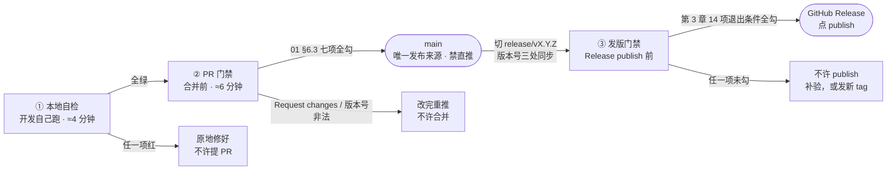

# 写作面板系统 · 质量门禁与验收标准 DoD

| 项目 | 内容 |
|------|------|
| 项目名 | 写作面板系统 WritingPanelSystem |
| 仓库 | `github.com/likeweixue/Writingpanelsystem` |
| 适用范围 | **仅本仓库**。Electron 28 + electron-builder 24，纯 HTML/CSS/原生 JS，**无构建步骤**、**无 lint**、**无自动化测试框架**的桌面写作软件 |
| 文档版本 | **v1.2**（v1.0 于 2026-10-03 初版；v1.1 同步 `02` v1.1 的 4 项回补；v1.2 同步 `02` v1.2 的 Checklist 第 14 项与 PR 隔离规则，见文末修订记录） |
| 生效日期 | 2026-10-03 |
| Owner | 麻昌生（主力开发 · 兼任 Release Manager · 一人承担全部签字） |
| QA / 本文档维护 | 严过关 |
| 适用规模 | **1–3 人小团队（当前实际：麻昌生 1 人主力 + likeweixue 协作）** |
| 上游文档 | `docs/01-团队协作规范.md` v1.0（角色 / 标签 / 分支 / 提交 / Review 关注点 / 文件治理 / 版本号真源）<br>`docs/02-交付流程与版本发布.md` **v1.2**（分支模型 / **Release Checklist 14 项** / 冒烟 9 条 / 回滚红线 / **PR 隔离规则（02 §2.4）** / Node 降级规则 / 演进路线图） |

> **本文档的边界**：只定"什么算做完、什么算能发"。**不写测试代码、不引入 Jest/Playwright、不建任何测试配置文件、不动 `.github/`、不改任何源码**。所有检查命令一律以"手跑的 CLI 命令 + 人工勾选清单"形式给出，可直接复制执行，不需要安装任何新依赖。
>
> **可执行性硬约束**：本文档任何一条清单，若在 **10 分钟内走不完**，就视为设计失败。全篇以"1 人、10 分钟、无专职 QA"为上限来设计；需要更久的项一律标为**增量项**（仅命中特定条件时才做），不计入基线预算。

---

## 0. 设计前提与 10 分钟预算

> **一句话结论**：本仓库历史上最严重的问题几乎全部只在**打包态**暴露，所以门禁的重心不是"自动化跑多快"，而是"**每次发版必须有人真的把安装包打开点一遍，并且留下痕迹**"。

### 0.1 已核实的项目实情（本文档全部规则的依据，均已逐条核过行号）

| # | 事实 | 证据（真实路径与行号） |
|---|------|---------------------|
| 1 | 无构建步骤、无 lint、无测试框架 | 仓库根目录无 `eslint`/`tsconfig`/测试目录；`package.json:6-11` 只有 start/build 四个脚本 |
| 2 | `index.html` 用 `<script src>` 顺序加载，`index.html:386-408` 顺序即依赖 | `index.html:386-408` |
| 3 | 用户作品数据全在 localStorage，无云端 | `js/data.js:34/38/42/46/68`（`wps_groups`/`wps_trash`/`wps_data`）；`js/outline.js:13`（`openwrite_outline_<bookId>`）；`js/characters.js:13`；`js/setting.js:13`；`js/notes.js:13`；`js/timeline.js:13`；`js/relation.js:14`；`js/dictionary.js:59`；`js/namegen.js:17`；`js/whiteboard.js:16`；`js/dialogue.js:18`；`js/links.js:15`；`js/jianghu.js:53/54`；`js/settings.js:513/550`（`app_theme`）；`js/toolbar.js:891/959`（`custom_bg_image`） |
| 4 | 唯一本地兜底备份通道 | `main.js:10` `~/Documents/写作面板系统备份/`；`preload.js:5-7` `backupBook`/`backupAllBooks`/`openBackupFolder` |
| 5 | 打包后 `window.open` 受主进程拦截策略控制 | `main.js:190-230` `setWindowOpenHandler`；放行策略含 `file://` / `blob:` / `data:` / `about:` / `.html` / `__panel__` |
| 6 | 「⤢ 放大面板」已改为先写文件再打开 | `preload.js:21` `writePanelFile` → `main.js:414-428` `write-panel-file`（写到 `app.getPath('userData')/panels/*.html`）→ `js/panel-window.js:134-155` `openPanelWindow` |
| 7 | 9 个工具模块各自调用 `openPanelWindow` | `js/characters.js:1610`、`js/outline.js:1922`、`js/dictionary.js:1521`、`js/whiteboard.js:807`、`js/namegen.js:831`、`js/relation.js:1381`、`js/setting.js:1665`、`js/timeline.js:1687`、`js/notes.js:1572` |
| 8 | 导出 DOCX 依赖外部 CDN | `index.html:4` `https://cdn.jsdelivr.net/npm/docx@8.5.0` |
| 9 | 版本号三处不一致且真源非法 | `package.json:3` = `"v 1.12.0"`；`README.md:6` = `release-v1.9.1`；`main.js:276` 硬编码 `版本 1.9.1` |
| 10 | 大文件集中 | `js/books.js` 126K、`js/toolbar.js` 117K、`js/dictionary.js` 99K、`js/outline.js` 89K、`js/characters.js` 87K、`js/setting.js` 87K、`js/timeline.js` 85K、`js/notes.js` 75K、`js/relation.js` 69K |
| 11 | 临时/调试文件仍留在仓库 | `js/temp_books.js`（0 字节）、`js/temp_switchpage.js`、`js/openbook_fix.js` |
| 12 | CI 只打包不发布、无门禁 | `.github/workflows/build.yml:1-60`（push tag `v*` → 双 job → `upload-artifact`，无 Release step、无 lint/test） |
| 13 | 本机是 macOS，**Windows 安装包只能靠 CI 产出** | 工作目录 `/Users/machangsheng/...`；`package.json:9` `build-win`；`build.yml:12` `runs-on: windows-latest` |
| 14 | 本机尚未 `git init` | 仓库根目录无 `.git`（01 §0 债务 #1、02 §0.3 #5 同） |
| 15 | **本机 Node 与 CI 不一致**：本机实测 **v22.22.2**，CI `build.yml:20/46` = **18** | `node -v` 实测；`build.yml:20` `node-version: 18`。02 §8.1 已给降级规则 A/B（第 4.4 节） |
| 16 | **`index.html` 有「两段」内联 `<script>`，其中第二段在 `</html>` 之后、靠浏览器容错才生效** | 第一段 `index.html:178-382`（约 205 行，含 `index.html:360-361` 的新建书籍/分组绑定）；第二段 `index.html:413-479`（约 67 行，`index.html:412` 的 `</html>` 之后）。**打包态是否与开发态一致尚未经验证** —— 已由 02 列为「打包后才暴露的行为差异」典型候选，见第 5.6 节与第 7.3 节第 6 项 |

### 0.2 10 分钟预算分配（超过就是设计失败）

| 门禁层 | 基线预算 | 内容 | 增量项（不计入基线） |
|-------|---------|------|--------------------|
| ① 本地自检 | **≈ 4 分钟** | 第 2.3 节 8 项（命令 + 目视 + `npm start` 冒烟） | — |
| ② PR 门禁 | **≈ 6 分钟**（含写 PR 描述） | 第 2.4 节 8 项签字 | 命中 01 §6.1 高危清单 → 追加 10–15 分钟本地打一次 dmg 并启动复测（第 5.1 节） |
| ③ 发版门禁 | **不计入 10 分钟**（发版日专项） | 第 3 章 14 项退出条件 + 第 4 章双平台冒烟 | 双平台各约 15 分钟，排在迭代第 11–12 天（02 §2.3） |

> **为什么这样切**：10 分钟是"每次提交都愿意做"的上限。发版门禁是一次性专项，硬塞进 10 分钟只会导致省略，所以单列到发版日。

---

## 1. 三层门禁总览

> **一句话结论**：三层门禁 = **本地自检（自己拦自己）→ PR 门禁（合并前有人签字）→ 发版门禁（publish 前 Release Manager 签字）**，任一层红了就回到上一层修，不允许带着红灯往下走。

### 1.1 流转图



### 1.2 三层对照表（门槛 / 执行人 / 证据形式 / 不通过怎么办）

| 层 | 门槛 | 执行人 | 证据形式（留痕） | 不通过怎么办 |
|----|------|-------|----------------|------------|
| **① 本地自检** | 第 2.3 节 8 项全绿 | 麻昌生（自己） | **命令输出**整段复制进 PR 描述；`npm start` 冒烟结论一句话 | 原地修；修不好就不许推分支（02 §2.2 步骤 1） |
| **② PR 门禁** | 第 2.4 节 8 项全勾 + 01 §6.3 七项全勾 | 麻昌生自检；命中 01 §6.1 高危的由 **likeweixue** 签字（缺省走 01 §1.3 单人简化路径） | **PR 链接 + PR 描述里的勾选清单**；高危项附**截图** | Reviewer Request changes → 改完重推；48h 无响应按 01 §6.4 由 Owner 自行合并并留"单人合并 + 回滚方案"评论 |
| **③ 发版门禁** | 第 3 章 14 项退出条件全勾 + 第 4 章双平台冒烟各 9 条 | **Release Manager（麻昌生，唯一可打 tag 与点 publish 的人）** | **截图 + 命令输出 + artifact 下载链接 + Release 草稿链接**，见第 11 章 | **不许点 publish**。补验后重走，或按 02 §4.5（含孤儿 tag 规则）发新 tag |

### 1.3 三层的共通铁律

| # | 铁律 |
|---|------|
| 1 | **红灯不下流**：任一层未全绿，禁止进入下一层。没有"先合并下次再补" |
| 2 | **没有证据 = 没做**：声称通过但拿不出证据（命令输出 / 截图 / PR 链接）的，一律判定为**未通过** |
| 3 | **一人也要签字**：1 人团队时"签字"= 在 PR / Release 描述里**写下勾选清单 + 时间戳**，不是心里记得做过 |
| 4 | **门禁只增不减**：hotfix 场景只跳过"等双周周期"（02 §6.2），其余全保留（第 5.5 节） |

---

## 2. DoD 与 DoR 定义

> **一句话结论**：**DoR（可开工标准）保证不做不该做的任务，DoD（完成标准）保证做完的任务真的能用**；本项目把 DoD 拆成"基线 8 项（约 4 分钟）+ 高危增量项"，确保 1 个人也执行得下去。

### 2.1 Definition of Ready（可开工标准）

> 不满足 DoR 的 Issue **不进本迭代**，直接在 Issue 上打 `needs-decision` 等麻昌生拍板（01 §3.1）。

| # | DoR 项 | 不满足的后果 |
|---|-------|------------|
| 1 | 有明确的【现象 / 期望】，bug 类必填【复现步骤】（01 §3.2 模板） | 无法验收 → 打 `needs-decision` |
| 2 | 已标注 **type + priority + area** 三类标签（01 §3.1） | 无法排期 |
| 3 | **已写明验收标准**，且是可判定的（"点 X 出现 Y"，不是"体验更好"） | DoD 无从判定 |
| 4 | 涉及 localStorage 键/结构变更的，**已写迁移与兜底方案**（否则打 `risk:data-loss` 且优先级 +1） | 直接打 `risk:data-loss`，走 01 §6.1 第 3 项强制 review |
| 5 | 涉及平台差异的已打 `platform:windows` / `platform:macos` / `platform:both` | Windows 端无人验证 → 见第 12 章待拍板项 #1 |
| 6 | 一个 Issue 一件事，预估改动 ≥ 400 行的**已拆分**（01 §4.4） | 拆完再开工 |
| 7 | 依赖的前置任务已完成（如"仓库已 git 初始化"） | 卡在 02 §2.2 步骤 0 |

### 2.2 Definition of Done（单个任务完成标准）

> **一句话结论**：**DoD = 本地自检 8 项（基线）+ 高危增量项 + PR 门禁 7 项签字**。全部达成，任务才算"完成"（Done），否则永远是"进行中"。

| 维度 | 完成标准 |
|------|---------|
| 功能 | 在 `npm start` 下按 Issue 的验收标准逐条复现通过 |
| 打包 | 命中 01 §6.1 高危清单的，**必须**在安装包（dmg）里复测通过（第 5.1 节） |
| 数据 | 旧版本真实数据升级后不丢失、不为空（第 5.2 节） |
| 代码 | 语法通过、脚本顺序正确、无临时文件、无关键路径 `console.log` 残留（第 9.2 节命令） |
| 版本 | 若涉及发版，版本号三处一致且合法 semver（第 5.4 节，一票否决） |
| 流程 | 提交信息合规（01 §5）、PR 描述勾选完整、关联 Issue 已关 |
| 证据 | 第 11 章要求的留痕已产生 |

### 2.3 基线 8 项：本地自检（执行人：开发自己 · **≈ 4 分钟**）

> 每次 push 前必跑。**整段输出直接复制进 PR 描述**，这就是证据。

```bash
# ── 1) 版本号合法 + 三处一致（≈30 秒）─────────────────────
node -p "require('./package.json').version"          # 期望 1.12.0（无 v、无空格）
node -e "const v=require('./package.json').version; if(!/^\d+\.\d+\.\d+$/.test(v)){console.error('非法 semver:',JSON.stringify(v));process.exit(1)} console.log('semver OK',v)"
grep -n 'release-v' README.md                        # 期望 release-v1.12.0
grep -n 'appVersion\|版本 1\.' main.js                # 期望出现 appVersion，不再有 1.9.1

# ── 2) 全量 JS 语法检查（≈30 秒，零依赖）─────────────────
node --check main.js && node --check preload.js && echo "main/preload OK"
for f in js/*.js; do node --check "$f" || echo "语法错误: $f"; done; echo "js/ 全部检查完毕"

# ── 3) 脚本加载顺序快照（≈60 秒，目视 + 贴进 PR）──────────
grep -n '<script src="js/' index.html

# ── 4) 临时文件 / 0 字节 / console.log 残留（≈60 秒）──────
git status --porcelain
find js -name "temp_*" -o -name "*_fix.js" -o -name "debug_*" -o -type f -size 0
grep -rc "console\.log" js/*.js | grep -v ":0$"      # 人工判断是否在关键路径

# ── 5) 9 个面板模块都已接入 openPanelWindow（≈10 秒）───────
grep -c "openPanelWindow" js/characters.js js/outline.js js/dictionary.js js/whiteboard.js js/namegen.js js/relation.js js/setting.js js/timeline.js js/notes.js
# 期望 9 行均 >= 1；任何一行出现 0 → 该模块的「⤢」没有走统一通道，本次不许合并

# ── 6) npm start 冒烟：按 Issue 验收标准点一遍（≈90 秒）───
npm start
```

| # | 自检项 | 期望 | 耗时 | 不通过 |
|---|-------|------|------|-------|
| 1 | 版本号合法且三处一致 | `1.12.0`；README 徽章同号；`main.js` 用 `appVersion` | 30s | **一票否决**，PR 不予合并（第 5.4 节） |
| 2 | 全量 JS 语法通过 | 无任何 `语法错误:` 输出 | 30s | 修语法，不许推分支 |
| 3 | 脚本顺序快照与上一版一致（或变更已说明理由） | `data.js` 第一、`panel-window.js` 在各工具前、`books.js` 在各工具后 | 60s | 命中 01 §6.1 第 1 项 → 转高危流程 |
| 4 | 无 `temp_*` / `*_fix.js` / 0 字节残留 | 三条 find 均无输出 | 60s | 删除后重跑（注意：`js/openbook_fix.js` 与 `js/temp_switchpage.js` 已确认未被 `index.html` 引入，可安全删除） |
| 5 | 9 个面板模块接入 `openPanelWindow` | 9 行计数均 ≥ 1 | 10s | 该模块「⤢」未走统一通道 → 打包态必挂 |
| 6 | `npm start` 下按 Issue 验收标准复现通过 | 行为符合期望 | 90s | 回到开发态修 |
| 7 | **无 `console.log` 残留**（关键路径） | 人工筛后为 0 或仅保留有意义的日志 | 30s | 清理后重跑 |
| 8 | 提交信息符合 01 §5 | `<type>(<scope>): <中文subject>` | 20s | 改提交信息（`git commit --amend`） |

### 2.4 PR 门禁 7 项签字（执行人：麻昌生自检 / 高危项由 likeweixue 签字 · **≈ 6 分钟**）

> 直接复制进 PR 描述。**这就是本项目的"质量门禁"，不落地任何配置文件。**

```
【PR 自检模板（03-DoD §2.4）——复制进 PR 描述】
- [ ] 1. 本地自检 8 项全绿，命令输出见下方折叠块
- [ ] 2. 01 §6.3 合并条件 7 项已逐条确认
- [ ] 3. 01 §6.2 关注点 ①②③（脚本顺序 / localStorage 兼容 / 打包差异）已逐条确认
- [ ] 4. 命中 01 §6.1 高危清单第 __ 项 → 已由 ________ 于 __:__ 签字（单人时填"隔夜自审"）
- [ ] 5. 打包敏感改动 → 已本地 `npm run build-mac` 并启动 dmg 复测（第 5.1 节），截图：____
- [ ] 6. 关联 Issue #__ 的验收标准已全部勾选
- [ ] 7. 版本号三处一致（若本次涉及发版）：package.json=__ / README=__ / main.js=__
- [ ] 8. 本 PR 是否动了 `index.html` 的脚本顺序或内联 `<script>`？否 → 跳过；是 → **必须是独立的 `chore/`/`fix/` PR 且无任何功能改动夹带**（§2.5 / §5.6）
```

| # | 签字项 | 签字人 | 通过证据 | 不通过怎么办 |
|---|-------|-------|---------|------------|
| 1 | 本地自检 8 项全绿 | 麻昌生 | PR 描述里粘贴的命令输出 | 补跑后重推 |
| 2 | 01 §6.3 合并条件 7 项 | 麻昌生 | PR 描述勾选 | 补齐 |
| 3 | 01 §6.2 ① ② ③ 三项逐条确认 | 麻昌生 | PR 描述写明"① 顺序未变 / ② 旧数据已回归 / ③ 已在 dmg 复测" | 补齐 |
| 4 | 01 §6.1 高危场景已有人审 | **likeweixue**（缺省时麻昌生走 01 §1.3 隔夜自审） | Review 的 Approve 评论；单人时为"隔夜自审 + 时间戳" | 有 Request changes → 改完重推 |
| 5 | 打包敏感改动已在 dmg 复测 | 麻昌生 | **截图**（见第 11 章命名规范） | 无截图 = 未通过 |
| 6 | 关联 Issue 验收标准已勾选 | 麻昌生 | Issue 链接 + 勾选状态 | 补齐 |
| 7 | 版本号三处一致（涉发版时） | 麻昌生 | 三处版本号逐字写出 | **一票否决** |
| **8** | **PR 隔离**：若本 PR 动了 `index.html` 的脚本加载顺序或任何内联 `<script>`，必须**单独开 `chore/` / `fix/` PR 且零功能夹带** | 麻昌生自检；命中即由 **likeweixue** 签字 | **PR 链接 + diff 说明**：PR 分支前缀是 `chore/`/`fix/`，且 diff 里只有脚本/顺序改动 | **发现夹带 → Reviewer 直接 Request changes，不进入逐行审**；拆成两个 PR 后重提 |

### 2.5 PR 隔离规则（02 §2.4 · 高危改动不许混提）

> **一句话结论**：动 `index.html` 脚本加载顺序或任何内联 `<script>` 的改动，**必须单独开 `chore/` 或 `fix/` PR（不要用 `feature/`、`refactor/`），一个功能改动都不许夹带**；发现夹带 → Reviewer 直接 Request changes、不进入逐行审；**先合高危隔离 PR，再合功能 PR，功能 PR 从已合并的 `main` 重新切出**。

| 项 | 规则 |
|----|------|
| **触发范围** | ① 改动 `index.html:386-408` 的 `<script src>` 顺序或增删引入；② 改动 `index.html` 内**任何**内联 `<script>`（当前共两段：`index.html:178-382` 与 `index.html:413-479`） |
| **分支类型** | **必须** `chore/` 或 `fix/`；**禁止**用 `feature/` / `refactor/`（这两类天然会带功能意图，容易混入） |
| **夹带红线** | PR 内**不得有任何功能改动**（01 §4.4 禁止夹带）。diff 里只允许出现：脚本顺序调整、内联脚本的迁移/删除/合并、配套的 `index.html` 注释 |
| **夹带怎么判** | Reviewer 先看分支前缀与 diff 范围；**一旦发现夹带，直接 Request changes，不进入逐行审**（避免"审完了才说要拆"的返工） |
| **合入顺序** | **先合高危隔离 PR → 再合功能 PR**；功能 PR 必须**从已合并的 `main` 重新切出**（`git switch main && git pull --ff-only && git switch -c feature/xxx`），否则会带上隔离前的旧基线 |
| **为什么这么严** | 脚本顺序即依赖、错序直接白屏（01 §6.2①）；而内联脚本处在 `</html>` 之后、靠浏览器容错生效（§0.1 #16），**打包态行为未经验证**。这两类改动一旦和功能改动混在一个 PR 里，出问题无法快速二分定位，也无法单独 revert |
| **与发版门禁的关系** | 第 3 章第 14 项「高危改动未混提」就是这条规则在发版时的复核口径 |

---

## 3. 发版门禁：Release Checklist 14 项 → 退出条件

> **一句话结论**：02 §5 的 14 项检查项（v1.1 新增第 13 项「本机 Node 与 CI 一致」，v1.2 新增第 14 项「高危改动未混提」）在这里被转写为**带签字人和通过证据的"退出条件"**——**14 项全部打勾才允许点 Release 的 publish，缺一项就是不许发**。

| # | 退出条件（源自 02 §5） | 谁签字 | **什么算通过证据** | 不通过怎么办 |
|---|---------------------|-------|------------------|------------|
| 1 | 版本号三处一致：`package.json:3` = `README.md:6` 徽章 = `main.js:276` 关于对话框 | Release Manager | **命令输出**：三条 grep/`node -p` 结果贴进 Release 草稿 | PR 打回。**不得 publish** |
| 2 | `package.json:3` 是合法 semver（无 `v`、无空格） | Release Manager | **命令输出**：`node -e` 校验打印 `semver OK 1.12.0` | **一票否决**（第 5.4 节），不得 publish |
| 3 | **双平台安装包实际启动冒烟**（不是 `npm start`） | Release Manager | **两张勾选清单**（第 4 章 Win/Mac 各 9 条）+ **≥3 张截图 / 平台** | 任一用例失败 → 不创建 Release，修完走 `hotfix/` 或下一个 tag（02 §2.2 步骤 8） |
| 4 | **localStorage 旧数据兼容** | Release Manager | **命令输出 + 截图**：升级前后在 Console 跑键名清单命令（第 5.2 节），两张输出对比键名与条数一致 | 升级后数据为空 → P0，走 `hotfix/`（第 8 章） |
| 5 | **CDN 依赖可用性**（`index.html:4` 的 `docx@8.5.0`） | Release Manager | **截图**：断网状态下点"导出 DOCX"，界面出现明确提示弹窗 | 静默失败（点了没反应、无报错）→ 判不通过，必须先加提示（第 5.3 节） |
| 6 | **打包态专属用例**：面板窗口 `⤢`、文件读写路径、图标资源 | Release Manager | **截图**：安装包里 9 个工具的「⤢」逐个点开的窗口截图（≥9 张） | 任一窗口打不开或弹"请允许弹出窗口"→ **判不通过**，打 `bug:package-only` |
| 7 | **数据备份通道可用** | Release Manager | **截图**：点"备份全部"后 `~/Documents/写作面板系统备份/`（`main.js:10`）下的文件列表 | 目录为空或按钮无反应 → 不通过（这是数据事故的唯一兜底） |
| 8 | 无临时文件 / 0 字节 / 关键路径 `console.log` 残留 | Release Manager（Owner 可裁决） | **命令输出**：`git status --porcelain` 与两条 `find` 均为空 | 清理后重跑；Owner 可书面裁决例外并记入 Release 已知问题 |
| 9 | 01 §6.3 合并条件 7 项全过 | Reviewer | **PR 链接**逐个贴进 Release 草稿 | 有未解决的 Request changes → 不合并 |
| 10 | 01 §8.3 发版同步清单 7 项全过 | Release Manager | Release 草稿里逐项打勾的文字清单 | 漏同步徽章 → 补 `docs/` PR 后再发 |
| 11 | **README / 更新日志同步**：徽章版本号、Release 说明含「新增 / 修复 / 已知问题」 | Owner | **Release 草稿链接** | 通读一遍再 publish |
| 12 | 已知问题里写明 macOS/Windows **未签名的打开方式** | Owner | Release 说明含"右键 → 打开" / "更多信息 → 仍要运行" | 若已签名则可省；未签名必须写（02 §3.2 ③④） |
| **13** | **本机 Node 与 CI 一致**（当前本机 v22.22.2 vs CI 18，**不一致**） | Release Manager | **命令输出**：`node -v` 与 `build.yml:20` 的 18 对比，**并写明采用降级规则 A 还是 B**（02 §8.1） | 选 A：本机切 Node 18 重打 dmg 后复测；**选 B：本机 dmg 冒烟结论降级为"参考值"、不算门禁通过，macOS 列必须用 CI 产出的 dmg 重验**（第 4.4 节）。**选 B 必须在 PR/Release 里注明"采用降级规则 B"**，未注明视为未通过 |
| **14** | **高危改动未混提（不可夹带项）**：本期若动过 `index.html` 的脚本加载顺序或**任何内联 `<script>`**，该改动是否**单独开了一个 `chore/` / `fix/` PR**、且 PR 内**无任何功能改动** | Release Manager | **PR 链接逐个贴进 Release 草稿**：逐个检查本期合并进 `main` 的 PR，命中触发范围的确认它是独立 PR，且 diff 里只有脚本/顺序改动（无功能改动） | 发现夹带 → 打回拆分为两个 PR（先隔离开、再功能），重走 review；**不许带夹带发版**。详见第 2.5 节与第 5.6 节 |

### 3.1 publish 前的最后一道确认（一句话）

> **14 项里只要有任何一项的"证据"栏是空的，就不许点 publish。** 没有证据 = 没做，这是本文档唯一不能妥协的规则。

---

## 4. 安装包冒烟：9 条 × 双平台分别留痕

> **一句话结论**：02 §5.1 的 9 条用例，在**每个平台的安装包上各跑一遍并各自留痕**——本机只能跑 macOS，Windows 必须留下 artifact 冒烟记录，这是拦住打包态缺陷的**最后一道关**。

> **双平台分别留痕（强制，02 §5.1）**：9 条用例必须在 **Windows 与 macOS 两个安装包上各跑一遍、分别独立勾选**，**不得用"一个平台通过"代表两个平台通过**——理由正是用例 4 这类缺陷历史上表现为**平台相关**。

### 4.1 用例定义（两平台共用）

| # | 用例 | 期望 | **不通过判定** |
|---|------|------|--------------|
| 1 | 安装 → 首次启动 → 启动画面 → 主界面加载 | 无白屏、无控制台报错 | 白屏 / 控制台 `is not defined` |
| 2 | 新建书籍 → 写一段正文 → 关闭 → 重开 | 内容还在（localStorage 落盘） | 重开后正文为空 |
| 3 | 打开九大工具（大纲/角色/设定/时间线/关系图/词典/起名/无边记/笔记）各一次 | 都能打开，无 `is not defined` | 任一工具打不开或控制台报错 |
| 4 | **九个工具逐个点一次 `⤢` 放大面板**（大纲 / 角色 / 设定 / 时间线 / 关系图 / 词典 / 起名 / 无边记 / 笔记） | 弹出独立窗口且内容正常 | 弹"请允许弹出窗口"或窗口空白（历史缺陷区，`main.js:190`；本项目头号杀手） |
| 5 | **导出 DOCX** | 成功生成文件；断网时至少有明确提示 | 点导出无反应、无报错（静默失败） |
| 6 | 导入 / 导出书籍（ZIP） | 往返一致 | 导入后章节缺失或乱码 |
| 7 | 主题切换 + 自定义背景图 | 生效且重开后保持 | 重开后恢复默认主题 |
| 8 | 执行"备份全部" → 打开备份文件夹 | `~/Documents/写作面板系统备份/` 下有文件 | 目录为空 |
| 9 | 用**旧版本的数据**打开新版本 | 全部历史数据可读 | 章节/角色/词典/时间线任一为空 |

### 4.2 Windows 留痕清单（NSIS exe · 由 CI artifact 产出后验证）

```
版本：v______  安装包来源：CI artifact `WritingPanelSystem-Windows`  验证人：______  日期：______
- [ ] 1. 首次启动无白屏
- [ ] 2. 新建书籍写正文，重开还在
- [ ] 3. 九大工具各打开一次
- [ ] 4. 9 个 `⤢` 面板逐个弹出（历史缺陷区，必测）
- [ ] 5. 导出 DOCX（含断网提示）
- [ ] 6. 导入 / 导出书籍 ZIP 往返一致
- [ ] 7. 主题切换 + 自定义背景，重开保持
- [ ] 8. 备份全部 → 备份文件夹有文件
- [ ] 9. 旧版本数据可读
截图：win-01-first-launch.png / win-04-panel-outline.png / win-05-export-docx.png（≥3 张）
```

### 4.3 macOS 留痕清单（dmg · 本机可直接验证）

```
版本：v______  安装包来源：□ 本机 `npm run build-mac`   □ CI artifact `WritingPanelSystem-macOS`
降级规则（02 §8.1）：□ A 本机已切 Node 18   □ B 未对齐 → 必须用 CI 的 dmg 验，本机产物仅作参考
验证人：______  日期：______
- [ ] 1. 首次启动无白屏（含 Gatekeeper 拦截处理：右键 → 打开）
- [ ] 2. 新建书籍写正文，重开还在
- [ ] 3. 九大工具各打开一次
- [ ] 4. 9 个 `⤢` 面板逐个弹出（历史缺陷区，必测）
- [ ] 5. 导出 DOCX（含断网提示）
- [ ] 6. 导入 / 导出书籍 ZIP 往返一致
- [ ] 7. 主题切换 + 自定义背景，重开保持
- [ ] 8. 备份全部 → 备份文件夹有文件
- [ ] 9. 旧版本数据可读
截图：mac-01-first-launch.png / mac-04-panel-outline.png / mac-05-export-docx.png（≥3 张）
```

| 平台 | 谁验 | 怎么拿安装包 | 留痕放哪 |
|------|------|------------|---------|
| **macOS** | 麻昌生（本机） | **降级规则 A**：本机切 Node 18 后 `npm run build-mac` → `dist/*.dmg`<br>**降级规则 B**：**必须用 CI 产出的 dmg**（本机 `npm run build-mac` 产物**不能代替**） | 第 11 章规定的本地目录 |
| **Windows** | **待拍板**（见第 12 章 #1） | 只能从 CI 下载 `WritingPanelSystem-Windows` artifact | 同上；**并把勾选清单原文贴进 Release 草稿** |

> **降级规则 B 时的硬约束（02 §8.1）**：本机 Node 是 v22.22.2 而 CI 是 18，两者跑出来的 dmg **不保证一致**。因此只要没对齐，本机 dmg 的冒烟结论就**降级为"参考值"、不算门禁通过**，macOS 这一列必须用 CI 的 dmg 重验一遍。Windows 端本来就只能用 CI artifact，这条对它没有影响。

### 4.4 冒烟失败怎么办：孤儿 tag 处置（02 §4.5）

> **一句话结论**：冒烟失败时**不许删 tag、也不许补建 Release**——该 tag 直接作废为「内部验证包」，修完发下一个 PATCH tag。

| 项 | 处置（与 02 §4.5 逐字一致） |
|----|--------------------------|
| **触发状态** | tag 已推送 + CI 已产出 artifact + 冒烟失败 + Release 未创建 |
| **处置** | 该 tag **视作「内部验证包」，保留不删、不创建 Release**。修完后走下一个 PATCH tag（如 `v1.12.0` 冒烟失败 → 修完发 `v1.12.1`）。artifact 90 天后自动过期，无需人工清理 |
| **禁止** | 禁止删除或强推覆盖该 tag；禁止给它补建 Release；禁止复用同一 tag 号重推 |
| **留痕** | 孤儿 tag **不算发布版本**：**不进 README 徽章、不进更新日志**（`Help/更新日志.md`）；在对应 Issue 上留一条评论"vX.Y.Z 冒烟未通过，作废，正式版见 vX.Y.Z+1" |
| **指标登记** | 该版本**不计入**第 10 章的 M1–M7（因为它不是发布版本）；但 M4「人工冒烟漏检次数」要 +1 并在下一个正式版本登记 |

> **为什么允许孤儿 tag 存在**：第 2.2 节步骤 6 就 push tag 触发 CI，步骤 8 才下载 artifact 冒烟，冒烟失败必然发生在 tag 推送之后；而 02 §4.4 已定"已推送 tag 禁止删除或强推覆盖"。两者叠加必然产生这种状态，必须先给它一个明确定义，否则每次冒烟失败都会卡在"删不掉又不发得出去"。

---

## 5. 五条专项验收红线

> **一句话结论**：以下 5 条是本项目的"血泪区"，**每条都是一票否决**，且必须与 01 的标签体系、02 的红线保持一致。

### 5.1 红线一：打包态缺陷验收口径（`bug:package-only`）

> **一句话结论**：**`npm start` 通过不算通过**；判定通过的口径是「**安装包启动后功能正常**」，不符合的一律打 `bug:package-only` 标签。

| 项 | 口径 |
|----|------|
| **通过的定义** | 在**安装包**（Windows NSIS exe / macOS dmg）启动后，功能表现与期望一致，且控制台无 `is not defined` / `not allowed` 类报错 |
| **不算通过的情形** | 仅在 `npm start`（开发态）下通过；仅在浏览器里通过 |
| **什么改动必须走打包态复测** | 命中 01 §6.1 任意一项，尤其是：① 改 `index.html:386-408` 脚本顺序；② 改 `main.js` / `preload.js`；③ 改动 `js/panel-window.js` 公共模块；④ 新增/删除 `js/*.js`；⑤ 改 `package.json` 的 version/build/dependencies |
| **复测动作** | **降级规则 A**：本机切 Node 18 → `npm run build-mac` → **启动 `dist/*.dmg`**（不是 `npm start`）→ 复测第 4.3 节清单第 1/3/4/5 条<br>**降级规则 B**：本机结论只作参考，**门禁通过必须以 CI 产出的 dmg 为准**（02 §8.1） |
| **Windows 端** | 本机无法打包 → 只能下载 CI artifact 在 Windows 真机/虚拟机上验（第 12 章 #1） |
| **缺陷标签** | 只在打包态复现、开发态复现不了的 → 打 `bug:package-only`（01 §3.1）+ `area:packaging` |
| **典型案例（本项目真实发生）** | 侧边栏「⤢ 放大面板」用 `window.open('', '_blank')` 空 URL，被 `main.js:190` 的 `setWindowOpenHandler` 判为外部链接 deny → 返回 `null` → 弹"请允许弹出窗口"（`js/panel-window.js:10` 注释）。**浏览器与 `npm start` 下完全正常，只有打包成 exe/dmg 后失效**。现已改为：`openPanelWindow`（`js/panel-window.js:134`）→ IPC `write-panel-file`（`preload.js:21` → `main.js:414-428`）把 HTML 写到 `app.getPath('userData')/panels/*.html` → `window.open(file://...)` |
| **验收必查** | 9 个模块的「⤢」在**安装包**里逐个点开（第 4 章用例 4）。**这是本项目的头号回归点** |

### 5.2 红线二：localStorage 兼容性（与 02 §7.2 完全一致的 5 条）

> **一句话结论**：**新版本必须能读能写旧数据**；任何"让用户删数据重装"的方案都不是修复，是数据丢失。

| # | 红线（违反即为事故，沿用 02 §7.2） | 验收动作 |
|---|----------------------------------|---------|
| 1 | **不得 `localStorage.clear()`，不得删除任何 `wps_*` / `openwrite_*` / `app_theme` / `custom_bg_image` / `custom_bg_opacity` 键** | 代码 diff 里搜 `localStorage.clear` / `removeItem`，命中即打回（唯一已知合法移除点是 `js/toolbar.js:979-980` 用户主动清除自定义背景，属用户显式操作） |
| 2 | **不得在回滚/修复代码里"顺手迁移"用户数据**——迁移只增不删，必须先在旧键上读取成功再写新键 | diff 中凡涉及键名变更的，必须同时看到"旧键读取 → 新键写入"的兜底分支 |
| 3 | **不得要求用户"删掉应用数据重装"**作为修复或回滚手段 | 若 PR 描述/Release 说明出现此类措辞 → 直接打回 |
| 4 | 涉及数据结构变更前，**必须先执行一次"备份全部"**（`preload.js:6` `backupAllBooks`），确认 `~/Documents/写作面板系统备份/`（`main.js:10`）下有产物 | 截图为证 |
| 5 | **回滚提交本身也要走 PR + Review**（01 §6.1 第 3 项），不得因为是"回滚"就直推 `main` | PR 链接为证 |

**验收动作（强制作，1 分钟）**：升级前后各跑一次下面这条，**两张输出必须键名集合一致、条数不减**。

```javascript
// 在应用窗口的开发者工具 Console 里执行（Electron：Ctrl/Cmd+Shift+I）
Object.keys(localStorage)
  .filter(k => k.startsWith('wps_') || k.startsWith('openwrite_') || ['app_theme','custom_bg_image','custom_bg_opacity'].includes(k))
  .sort()
  .map(k => k + ' = ' + (localStorage.getItem(k) || '').length + 'B')
```

| 判定 | 标准 |
|------|------|
| ✅ 通过 | 升级后键名集合 ⊇ 升级前，且每个键的内容长度 > 0，且各工具界面数据不为空 |
| ❌ 不通过 | 键名消失 / 变少 / 内容长度骤降 / 任一工具（大纲、角色、设定、时间线、关系图、词典、起名、无边记、笔记）数据变空 |

### 5.3 红线三：CDN 依赖（`index.html:4`）

> **一句话结论**：断网时导出 DOCX **必须给出明确提示**，静默失败一律判不通过；将来若决定本地化，口径改为「离线可用」。

| 项 | 口径 |
|----|------|
| 依赖位置 | `index.html:4` `https://cdn.jsdelivr.net/npm/docx@8.5.0/build/index.min.js` |
| **当前验收口径（沿用 02 §8.4"短期方案 B"）** | 断网状态下打开安装包 → 点"导出 DOCX" → **必须出现明确提示**（弹窗或 Toast，说明"导出需要联网加载组件，请检查网络后重试"）；**点完没反应、无报错 = 静默失败 = 判不通过** |
| 怎么验（1 分钟） | 断开 Wi-Fi → 启动安装包 → 新建书籍写一句话 → 导出 DOCX → 截图 |
| 联网友好路径也要验 | 联网状态下导出 DOCX 必须成功生成文件（第 4 章用例 5） |
| **将来改口径的条件** | 若按 02 §10 待拍板项 #4 决定把 `docx` 本地化（照 `jszip.min.js` 的现有做法放进仓库），则本条口径**改为「断网状态下导出 DOCX 必须成功」**，并同步修订本表 |
| 关联 | 02 §5 第 5 项、02 §8.4；本条不通过 → 02 §5 第 5 项不通过 → 不许 publish |

### 5.4 红线四：版本号治理（**一票否决**）

> **一句话结论**：`package.json:3` 的 version 必须匹配 `^\d+\.\d+\.\d+$`，且与 `README.md:6` 徽章、`main.js:276` 关于对话框三处一致；**不合格的 PR 一律不合并**。

| 位置 | 当前值（已核实） | 应改为 | 判定 |
|------|---------------|-------|------|
| `package.json:3` | `"version": "v 1.12.0"`（**非法 semver**：含 `v` 与空格） | `"1.12.0"` | ❌ 当前不合格 |
| `README.md:6` | `release-v1.9.1` | `release-v1.12.0` | ❌ 当前不合格 |
| `main.js:276` | `版本 1.9.1`（硬编码） | 读取 `package.json` 的 version（模板字符串 `${appVersion}`） | ❌ 当前不合格 |

**一票否决规则**：

| 规则 | 说明 |
|------|------|
| 触发 | 任一 PR 改动了 `package.json` 的 version 字段，或处于发版流程中 |
| 判定 | 三处不一致 → **PR 不予合并**；`package.json:3` 不匹配 `^\d+\.\d+\.\d+$` → **PR 不予合并** |
| 例外 | 无。**这是本文档唯一写明"不予合并"的硬性一票否决项** |
| 整改分支 | `fix/version-string-sync`（02 §4.3 给了 8 步具体操作） |
| 校验命令 | 见第 2.3 节第 1 条；`node -e` 那条退出码非 0 即判失败 |

### 5.5 红线五：hotfix 门禁不降级

> **一句话结论**：hotfix 只跳过"等双周周期"这一项，**01 §6.1 的高危 review 和 01 §6.4 的 4 小时响应在 hotfix 场景同样适用**，不得因"紧急"绕过。

| 门禁项 | 常规发布 | **Hotfix** | 是否降级 |
|-------|---------|-----------|---------|
| 等双周周期 | 是 | **跳过**（当天发） | ✅ **唯一可跳过的项**（02 §6.2） |
| 切出位置 | `main` | 出问题的 tag（`git switch -c hotfix/xxx v1.12.0`） | ❌ 不降 |
| 版本号三处同步（第 5.4 节） | 必须 | **必须** | ❌ 不降 |
| PR 合并回 `main`（禁直推） | 必须 | **必须** | ❌ 不降 |
| **01 §6.1 高危场景 review** | 必须 | **必须** | ❌ **不降**（02 §6.2） |
| **01 §6.4 响应时限** | 普通 PR 24h | **4 小时内首次响应** | ❌ **不降**（反而更严） |
| **打包态冒烟**（第 4 章 9 条） | 必须 | **必须** | ❌ 不降 |
| **localStorage 旧数据兼容**（第 5.2 节） | 必须 | **必须** | ❌ 不降 |
| 版本号递增 | MINOR/PATCH 按内容 | **一律 PATCH +1** | ❌ 不降 |
| 回补上一个 release 分支 | — | **必须**（02 §6.3） | ❌ 不降 |
| 第 2.4 节 PR 门禁 7 项 | 必须 | **必须** | ❌ 不降 |
| 第 3 章 13 项退出条件 | 必须 | **必须** | ❌ 不降 |

> **hotfix 的"快"从哪来**：只来自"不用等双周"和"只改最小必要改动（01 §4.4 禁止夹带）"，**不来自省略任何一道门禁**。若发现有人以"紧急"为由跳过 review 或冒烟，该 hotfix 视为无效，必须补跑后再发。

---

## 6. 桌面端专项回归清单

> **一句话结论**：按模块分组做成可勾选表，**其中「独立窗口形态（⤢）」一栏必须在打包态复测**——这正是本次 ⤢ 缺陷的复发点，也是本项目唯一被真实外泄过的严重缺陷形态。

### 6.1 使用方式

| 场景 | 跑哪些 |
|------|-------|
| 日常小改动（≤3 文件、非高危） | 只跑**受影响的模块分组** + 6.2 的第 1 组（书籍管理） |
| 命中 01 §6.1 高危清单 | 跑**全表**，且第 2 组「独立窗口形态」必须在 dmg 里跑 |
| 发版 | 跑**全表**（第 13 组备份通道必跑），两个平台各一遍 |

### 6.2 回归清单

```
版本：v______  运行方式：□ npm start   □ 安装包(dmg/exe)   日期：______
```

**第 1 组 · 书籍管理（`js/books.js`、`js/data.js`）**
- [ ] 新建 / 重命名 / 删除书籍
- [ ] 分组管理（新建分组、拖入书籍）
- [ ] 回收站软删除与恢复
- [ ] 封面图片上传（自动压缩）后重开仍在
- [ ] 稿费设置（每千字稿费 + 目标字数）保存后重开仍在

**第 2 组 · 写作编辑器（`js/toolbar.js`）**
- [ ] 富文本编辑与自动保存（1 秒防抖）
- [ ] 字数统计 + 稿费实时计算
- [ ] 双栏模式（左右对照编辑）
- [ ] 备忘录模式（右侧独立笔记区）
- [ ] 历史记录：Ctrl+Z 撤销 / Ctrl+Y 恢复

**第 3 组 · 九大工具 × 三种形态（`⤢` = 必须在打包态复测）**

| 工具 | 模块 | 侧边栏 | 标签页 | **独立窗口 ⤢（打包态必测）** |
|------|------|-------|-------|---------------------------|
| 📋 大纲 | `js/outline.js:1922` | - [ ] | - [ ] | - [ ] |
| 👥 角色 | `js/characters.js:1610` | - [ ] | - [ ] | - [ ] |
| ⚙️ 设定 | `js/setting.js:1665` | - [ ] | - [ ] | - [ ] |
| ⏱️ 时间线 | `js/timeline.js:1687` | - [ ] | - [ ] | - [ ] |
| 🔗 关系图 | `js/relation.js:1381` | - [ ] | - [ ] | - [ ] |
| 📚 词典 | `js/dictionary.js:1521` | - [ ] | - [ ] | - [ ] |
| ✏️ 起名 | `js/namegen.js:831` | - [ ] | - [ ] | - [ ] |
| 📝 无边记 | `js/whiteboard.js:807` | - [ ] | - [ ] | - [ ] |
| 📓 笔记 | `js/notes.js:1572` | - [ ] | - [ ] | - [ ] |

> **形态说明**：每个工具都支持**侧边栏 / 标签页 / 独立窗口**三种（README §核心功能）。**独立窗口形态即 `⤢`**，统一走 `js/panel-window.js:134` 的 `openPanelWindow`。
> **验收重点**：9 个 `⤢` 在**安装包**里必须逐个弹出独立窗口且内容正常；任一弹出"请允许弹出窗口"或空白 → 打 `bug:package-only`，本次不许发布。

**第 4 组 · 超链接（`js/links.js`）**
- [ ] 章节链接 `[[第一章]]` 跳转正确
- [ ] 词典链接 `[[词条]]` 打开词典并选中词条
- [ ] 锚点链接 `[[#伏笔1]]` 跳转正确
- [ ] 插入链接对话框可用
- [ ] `Ctrl+Shift+L` 插入链接 / `Ctrl+Shift+A` 添加锚点

**第 5 组 · 右键菜单（`js/contextmenu.js`）**
- [ ] 剪切 / 复制 / 粘贴 / 全选
- [ ] 标记颜色（9 种预设 + 自定义颜色）
- [ ] 从选中文字新建章节 / 角色 / 设定 / 词条
- [ ] 全书搜索
- [ ] 字数统计

**第 6 组 · 查找替换（`js/toolbar.js`）**
- [ ] 查找 / 替换当前章节
- [ ] 查找 / 替换全书
- [ ] 正则表达式支持
- [ ] 区分大小写 / 全字匹配
- [ ] 匹配统计与预览

**第 7 组 · 导入导出（`js/toolbar.js`、`jszip.min.js`、`index.html:4`）**
- [ ] 导入 TXT 自动分章
- [ ] 导入图片自动压缩
- [ ] 导出 TXT（单章 / 全书）
- [ ] **导出 DOCX（联网成功）**
- [ ] **导出 DOCX（断网有明确提示，不静默失败）** ← 第 5.3 节
- [ ] 全书导出按「书名/分卷/章节」打包 ZIP
- [ ] 导出 ZIP → 再导入 → 往返一致

**第 8 组 · 主题系统（`js/settings.js:513`、`js/toolbar.js:891` + `themes/*.css`）**
- [ ] 5 套预设主题逐个切换（default / eye / warm / dark / open）
- [ ] 自定义背景图上传 + 透明度调节
- [ ] 全局文字颜色设置
- [ ] 重开后主题与背景保持（`app_theme` / `custom_bg_image` / `custom_bg_opacity`）
- [ ] **`⤢` 面板窗口内主题与主窗口一致**（`js/panel-window.js:46` `getPanelTheme()`）

**第 9 组 · 快捷键（README §快捷键）**
- [ ] `Ctrl+N` 新建书籍
- [ ] `Ctrl+W` 关闭标签页 / `Ctrl+Tab` 切换标签页
- [ ] `Ctrl+S` 保存章节
- [ ] `Ctrl+F` 查找替换
- [ ] `Ctrl+Z` / `Ctrl+Y` 撤销恢复
- [ ] `Ctrl+Shift+O/T/R/E/G/W/N/M/D` 快速打开各工具
- [ ] `Ctrl+/` 快捷键帮助 / `F11` 全屏

**第 10 组 · 备份通道（`main.js:10`、`preload.js:5-7`）**
- [ ] 单本备份（`backupBook`）生成文件
- [ ] **备份全部（`backupAllBooks`）生成文件**
- [ ] 打开备份文件夹（`openBackupFolder`）能定位到 `~/Documents/写作面板系统备份/`
- [ ] 备份文件可被导入还原（往返可用）

---

## 7. 打包态专属测试（Windows NSIS / macOS dmg）

> **一句话结论**：除了功能用例，安装包还必须单独验**首次启动、权限、图标、任务栏、升级覆盖安装后数据是否还在、卸载重装数据是否还在**——这 6 项只在安装包形态下有意义，`npm start` 永远测不出来。

### 7.1 Windows（NSIS exe · 由 CI artifact 验证）

| # | 验收项 | 期望 | 不通过判定 |
|---|-------|------|-----------|
| 1 | 首次启动 | 安装 → 双击 exe → 启动画面 → 主界面，无白屏 | 白屏 / 闪退 / 控制台报错 |
| 2 | 权限与拦截 | SmartScreen 提示"未知发布者"时可点"更多信息 → 仍要运行"继续安装（02 §3.2 ④） | 无法继续安装 |
| 3 | 图标 | 桌面快捷方式、任务栏、窗口标题栏图标均正确显示（`package.json:26` `icon.ico`） | 图标缺失或为默认图标 |
| 4 | 任务栏 | 任务栏图标正确；`⤢` 面板窗口在任务栏有独立条目 | 面板窗口不开或任务栏无条目 |
| 5 | **升级覆盖安装后数据还在** | 在已装旧版本的机器上直接装新版本 → 打开后书籍/章节/大纲/角色/词典全在 | 任一数据为空 → P0，打 `risk:data-loss` |
| 6 | **卸载重装后数据还在** | 控制面板卸载 → 重装 → 打开后数据仍在 | 数据丢失 → P0。**注意**：`package.json:24-27` 的 win 段未显式配置 `deleteAppDataOnUninstall`，electron-builder 默认 `false`（即不删 AppData），预期数据应保留；**但必须以实测为准**，实测丢失则必须在 `package.json` 显式写 `deleteAppDataOnUninstall: false` 并在 Release 说明里写明"卸载不会删除作品数据" |
| 7 | 安装路径与写入权限 | 默认安装路径下能正常写入备份与图片 | 写入报权限错 |

### 7.2 macOS（dmg · 本机直接验证）

| # | 验收项 | 期望 | 不通过判定 |
|---|-------|------|-----------|
| 1 | 首次启动 | 打开 dmg → 拖入 Applications → 启动，无白屏 | 白屏 / 闪退 |
| 2 | 权限与拦截（未签名） | Gatekeeper 拦截时"右键 → 打开"可正常启动（02 §3.2 ③、02 §5 第 12 项） | 完全无法启动 |
| 3 | 图标 | Dock 图标、Finder 中 app 图标、`⤢` 面板窗口图标均正确（`package.json:30` `icon.icns`） | 图标缺失或为默认图标 |
| 4 | Dock / 菜单栏 | Dock 图标正确；应用菜单（关于/备份位置说明）可打开，版本号与 `package.json` 一致 | 版本号显示 1.9.1 或空白 |
| 5 | **升级覆盖安装后数据还在** | 用新 dmg 覆盖安装 → 打开后数据全在（**降级规则 B 时必须用 CI 的 dmg 验**） | 数据为空 → P0 |
| 6 | **卸载重装后数据还在** | 把 app 拖到废纸篓 → 重装 → 打开后数据仍在（数据在 `~/Library/Application Support/`，不在 app 包内） | 数据丢失 → P0。**Release 说明必须写明"手动删除 ~/Library/Application Support/WritingPanelSystem 会永久丢失作品"** |
| 7 | 备份目录写入 | 备份全部后 `~/Documents/写作面板系统备份/` 有文件 | 目录为空 |

### 7.3 两平台共有的"只有打包态才有"的检查

| # | 检查项 | 期望 |
|---|-------|------|
| 1 | 资源是否打进包 | `icons/`、`themes/`、`css/`、`js/`、`assets/`、`jszip.min.js`、`splash.html` 均在包内（图标/主题/背景不失效） |
| 2 | `file://` 路径读写 | `⤢` 面板经 `main.js:414-428` 写到 `userData/panels/*.html` 后能打开；面板内 localStorage 与主窗口同源共享 |
| 3 | 相对路径 / `__dirname` | 无"开发态能找到、打包后找不到"的路径写法 |
| 4 | 控制台无报错 | 打包态开发者工具 Console 无 `is not defined` / `not allowed` / `Failed to load resource` |
| 5 | 产物名与版本号 | dmg/exe 名含正确版本号（非法 semver 会污染产物名，见 02 §4.2） |

---

## 8. 缺陷分级与响应

> **一句话结论**：沿用 01 §3.3 的 P0–P3 分级，这里补齐**响应时限 / 修复时限 / 发布方式**三列，并全部用本项目真实缺陷举例；`risk:data-loss` 类自动 +1 级（最低不低于 P1）。

| 级别 | 定义 | **本项目真实举例** | 响应时限 | 修复时限 | 发布方式 |
|------|------|------------------|---------|---------|---------|
| **P0** | 用户数据丢失 / 崩溃 / 主流程不可用，且**已发布版本受影响** | 升级后 `openwrite_outline_<bookId>`（`js/outline.js:13`）读不出来，大纲全空；或 `wps_data`（`js/data.js:68`）解析异常导致书籍列表为空；应用启动即闪退 | **4 小时内**首次响应（01 §6.4） | **当天修完** | **`hotfix/` 分支 + PATCH +1**（如 `v1.12.0 → v1.12.1`），走第 5.5 节门禁不降级流程 |
| **P1** | 主要功能缺陷，影响多数用户 | **打包后「⤢ 放大面板」打不开**（`main.js:190` `setWindowOpenHandler` deny 空 URL → `window.open` 返回 `null` → 弹"请允许弹出窗口"）；导出 DOCX 静默失败无提示（`index.html:4` CDN 不可达）；卸载重装后数据丢失 | **24 小时内**（工作日，01 §6.4） | **本迭代内**（双周第 1–10 天） | 常规迭代 `fix/` 分支；**若已发布且核心功能完全不可用 → 升级为 hotfix** |
| **P2** | 体验优化、次要缺陷、技术债 | 5 套主题色表在 9 个模块各重复一份（`js/panel-window.js` 已抽出，精简 153 行）；`js/temp_books.js`（0 字节）、`js/temp_switchpage.js`、`js/openbook_fix.js` 残留；某工具的右键菜单项失效 | **本迭代内排期** | **下个迭代** | 常规迭代（`refactor/` 或 `chore/` 分支） |
| **P3** | 锦上添花、长期重构 | 拆分 `js/books.js`（126K）、`js/toolbar.js`（117K）；拆分后带来的命名与 `index.html` 顺序调整 | **不承诺时限**（在 Issue 上登记） | **有空再做**，不占迭代 | 不单独发版；合并进常规迭代 |

| 补充规则 | 说明 |
|---------|------|
| `risk:data-loss` | 优先级**自动 +1 级**，最低不低于 P1（01 §3.3）。命中即走 01 §6.1 第 3 项强制 review |
| `bug:package-only` | 不单独改变级别，但**强制要求打包态复测**（第 5.1 节），且修复后必须在**两个平台的安装包**上各验一次 |
| 平台差异 | 同级别缺陷，**Windows 端优先级 +1**（因为 Windows 验证机会最少，漏检代价最高） |
| 升级为 hotfix 的判据 | 见 02 §6.1：已发布 + 数据丢失/崩溃/主流程不可用/核心功能完全不可用/安全问题 |

---

## 9. 零自动化测试阶段的过渡方案

> **一句话结论**：在没有 Jest/Playwright 的现状下，用「**命令行零依赖检查 + 人工勾选清单 + 证据留痕**」三件套撑住质量；先做零成本、零维护的静态检查，自动化按"收益排序"慢慢来。

### 9.1 三件套如何替代自动化测试

| 自动化测试本该做的事 | 本项目的替代手段 | 覆盖度 |
|--------------------|----------------|-------|
| 语法检查 | 第 9.2 节命令 1（全量 `node --check`） | 100%（等价） |
| 依赖关系检查 | 第 9.2 节命令 3（`index.html` 脚本顺序快照，逐版 diff） | 人工目视，够用 |
| 数据兼容回归 | 第 5.2 节的 Console 键名清单对比 + 第 6.2 节回归清单 | 人工，但直击要害 |
| 打包态冒烟 | 第 4 章 9 条 × 双平台勾选清单 | **不可被自动化替代**（02 §9.1：自动化通过 ≠ 打包版能用） |
| 版本一致性 | 第 9.2 节命令 2（semver 正则）+ 命令 4（三处版本） | 100%（等价） |
| 代码质量 / 规范 | 01 §6.2 review 关注点 + 01 §7.1 三振出局 | 人工 |

### 9.2 立即可用的零依赖检查命令（复制即跑，不需要装任何东西）

```bash
# ── 1) 全量 JS 语法检查（零依赖，等价于阶段 2 的语法门禁）────────
node --check main.js && node --check preload.js && echo "main/preload OK"
for f in js/*.js; do node --check "$f" || echo "语法错误: $f"; done; echo "js/ done"

# ── 2) 版本号 semver 合法性（退出码非 0 即失败）──────────────────
node -e "const v=require('./package.json').version; if(!/^\d+\.\d+\.\d+$/.test(v)){console.error('非法 semver:',JSON.stringify(v));process.exit(1)} console.log('semver OK',v)"

# ── 3) index.html 脚本加载顺序快照（贴进 PR，逐版 diff）──────────
grep -n '<script src="js/' index.html > /tmp/script-order-$(node -p "require('./package.json').version").txt
cat /tmp/script-order-*.txt

# ── 4) 版本号三处一致（grep 用英文模式，避免中文环境问题）────────
node -p "require('./package.json').version"
grep -n 'release-v' README.md
grep -n 'appVersion' main.js          # 期望有；若 grep 到 '版本 1.' 说明还在硬编码

# ── 5) 文件体积检查（>60KB 触发拆分评估，01 §7.3）────────────────
find js -name "*.js" -size +60k -exec ls -lh {} \; | awk '{print $5, $9}'

# ── 6) 残留临时文件 / 0 字节文件 ──────────────────────────────────
find js -name "temp_*" -o -name "tmp_*" -o -name "debug_*" -o -name "*_fix.js" -o -type f -size 0
git status --porcelain

# ── 7) 运行时外部 CDN 依赖清单（应只有 index.html:4 一条）────────
grep -rn 'https://cdn\.' index.html js/ css/ 2>/dev/null

# ── 8) console.log 残留统计（人工筛关键路径）─────────────────────
grep -rc "console\.log" js/*.js main.js preload.js | grep -v ":0$"

# ── 9) 9 个面板模块是否都走 openPanelWindow 统一通道 ─────────────
grep -c "openPanelWindow" js/characters.js js/outline.js js/dictionary.js js/whiteboard.js js/namegen.js js/relation.js js/setting.js js/timeline.js js/notes.js

# ── 10) 重复代码哨兵（01 §7.1 三振出局）──────────────────────────
grep -rn "themeColors" js/ | grep -v "js/panel-window.js" ; echo "---"; grep -rn "window.open(" js/ | grep -v "js/panel-window.js"
```

| 命令 | 谁来跑 | 什么时候跑 | 失败即 |
|------|-------|-----------|-------|
| 1、2、4 | 开发 | 每次 push 前 | 不许提 PR |
| 3、5、6、7、8、9、10 | 开发 | 每次 push 前；3 与 5 另在发版时贴进 Release 草稿 | 3 → 转高危流程；9 出现 0 → 不许合并；其余 → 修完再提 |
| 全部 10 条 | Release Manager | 发版日（第 3 章第 1、2、8 项的证据） | 不许 publish |

### 9.3 未来引入自动化的优先级排序（收益从高到低）

> **排序依据**：`历史缺陷频率 × 机械化难度（越易越高） × 漏检代价`。

| 优先级 | 自动化对象 | **为什么它排这个位置** | 预估成本 | 对应 02 §9.1 |
|-------|-----------|---------------------|---------|-------------|
| **1** | **CI 静态检查**：`node --check` 全量 + semver 校验 + 脚本顺序快照比对 | **零依赖、零维护、一次配好永久有效**；直接拦住"语法错也能打包成功"和"版本号污染产物名"（02 §4.2）。收益/成本比断层第一 | 约 0.5 人日 | 阶段 2 |
| **2** | **打包态「⤢」面板窗口冒烟**（9 个模块各点一次并断言窗口出现） | **本项目唯一被真实外泄过的严重缺陷形态**（`main.js:190`）；9 个调用点一次性全覆盖；动作机械、断言简单（窗口是否打开）；**且只在打包态暴露，人工最容易漏** | 约 1–2 人日 | 阶段 3 第 4 条 |
| **3** | **localStorage 键清单快照 diff** | 升级前后键名集合自动比对，是**数据丢失的第一道自动哨兵**；实现只是跑一条 Console 表达式并 diff，成本极低 | 约 0.5 人日 | 阶段 2 扩展 |
| **4** | **导出 DOCX（含断网）** | 直接盯住 `index.html:4` 的 CDN 外链风险（`risk`：静默失败）；但需模拟离线环境，成本略高 | 约 1 人日 | 阶段 3 第 5 条 |
| **5** | **导入导出 ZIP 往返一致** | 往返一致可断言，但用例编写与 fixture 准备成本高于其发生频率 | 约 1–2 人日 | 阶段 3 第 6 条 |
| **6** | 新建书籍持久化（第 4 章用例 2） | 简单但很少出问题，收益有限 | 约 0.5 人日 | 阶段 3 第 2 条 |
| **7** | 主题 / 快捷键 / 右键菜单 / 查找替换 | 交互密集、断言脆弱、维护成本高，**投入产出比最低** | — | **不建议自动化**，维持人工清单 |
| — | ESLint / Prettier / TypeScript | 01 §9.2 与 02 §9.2 已判定**不建议**：现有大文件原生 JS 一开就是上千条告警；引入 TS 等于引入构建链 | — | 不做 |

> **红线**：即便自动化做到优先级 2，**也不能替代第 4 章的人工双平台冒烟**（02 §9.1 风险栏：无构建步骤的项目里测试环境与打包环境仍有差异，自动化通过 ≠ 打包版能用）。

---

## 10. 可观测指标与自动化升级判据

> **一句话结论**：02 §9 的"升级触发条件"在这里落成**可数、可登记的指标**——**每个 Release 结束花 5 分钟登记一次**，指标说话，不靠感觉决定要不要上自动化。

| # | 指标 | 定义（怎么数） | 采集方式 | **触发阈值** | 触发后做什么 |
|---|------|--------------|---------|------------|------------|
| **M1** | **打包态缺陷外泄次数** | 已发布版本中、被用户发现的 `bug:package-only` 缺陷数（01 §3.1 标签计数） | GitHub Issue 标签筛选 | 连续 2 个迭代各 ≥1，或单季度累计 ≥2 | **升级到阶段 3**（先做优先级 2：⤢ 面板自动化） |
| **M2** | **`risk:data-loss` 事故次数** | 用户数据读不出 / 显示为空 / 丢失的事故数 | Issue 标签 + Release 已知问题回溯 | 累计 ≥2 | 升级阶段 3 + **强制**每次发版跑旧数据回归（第 5.2 节） |
| **M3** | **语法 / 版本号导致打包失败次数** | CI 因 JS 语法错误或版本号非法而红掉的次数 | Actions 运行记录 | 累计 ≥2 | **立即升级到阶段 2**（02 §9.1 触发条件 A1） |
| **M4** | **人工冒烟漏检次数** | 发版后被发现、但第 4 章清单里**已有对应用例**的缺陷数 | Release 已知问题回溯 | 累计 ≥2 | **修订冒烟清单**（补步骤 / 拆粒度），**不是加人** |
| **M5** | **双平台冒烟耗时** | 一次完整双平台冒烟的实际分钟数 | 发版时顺手记录 | 连续 2 次 > 40 分钟 | 升级阶段 3（02 §9.1 触发条件 B 的成本侧） |
| **M6** | **协作者人数** | 实际参与 review 的人数 | GitHub 仓库成员 | ≥2 | 升级阶段 2（02 §9.1 触发条件 A2） |
| **M7** | **发版频率** | 平均多少天一个 Release | Release 时间线 | 提升到每周或更高 | 满足 B3，与 B1/B2 同时成立才升阶段 3 |

| 项 | 规定 |
|----|------|
| 采集人 | Release Manager（麻昌生） |
| 采集时机 | 每个 Release publish 后 **5 分钟内** |
| 登记位置 | Release 说明末尾加一小节「本期质量指标」；同步一行进 `Help/更新日志.md`（该文件已存在于仓库） |
| 登记格式 | `M1=0 M2=0 M3=0 M4=0 M5=30min M6=1 M7=14d` |
| 未登记 | 第 3 章第 11 项判不通过（Release 说明不完整） |

> **与 02 §9.1 触发条件的映射**：M3 → A1；M6 → A2；M1/M2 → B2；M7 → B3；B1（阶段 2 稳定运行 2 个迭代）由登记记录自身证明。

---

## 11. 留痕与证据规范

> **一句话结论**：**文字留痕（PR/Release 描述里的勾选）是主证据，截图是辅证**；截图放**仓库外**本地目录、按 `<平台>-<用例号>-<用例名>.png` 命名、保留最近 3 个版本。

| 项 | 规范 |
|----|------|
| **存放位置** | `~/Documents/写作面板系统验收留痕/<版本号>/`（**仓库外**，避免污染仓库与安装包体积）。理由：`package.json:32-36` 的 `files: ["**/*"]` 会把仓库内文件打进安装包 |
| **目录结构** | `~/Documents/写作面板系统验收留痕/v1.12.0/{macos,windows,commands}/` |
| **截图命名** | `<平台>-<用例号>-<用例名>.png`，如 `macos-04-panel-outline.png`、`windows-05-export-docx.png`；同用例多张加后缀 `-2` |
| **命令输出命名** | `commands/<平台>-<检查项>.txt`，如 `commands/pre-release-01-version.txt` |
| **保留周期** | **最近 3 个版本**（约 6 周）。超出即删除，不留历史堆积 |
| **清理时机** | 第 4 个版本 publish 后，删除最老版本的目录（5 分钟） |
| **主证据放哪** | **PR 描述**（第 2.4 节 7 项）与 **Release 草稿**（第 3 章 13 项 + 第 4 章双平台勾选清单 + 第 10 章指标行）。**这两处才是判定依据** |
| **截图放哪（对外）** | 一般不上传。仅在需要向 likeweixue 或用户说明时，才贴进 Issue/PR 评论 |
| **最少截图数** | macOS ≥3 张（首启、`⤢` 面板、导出 DOCX）；Windows ≥3 张（同三项）。第 3 章第 6 项要求 9 个 `⤢` 逐个验，但**截图至少保留 1 张 + 勾选清单写明"9 个均已点开"**即可 |
| **不许做的事** | 不许把截图提交进仓库；不许为留痕而留痕（清单勾选 + 一句话结论已足够，不要每张截图配一段说明） |

---

## 12. 待明确事项（需麻昌生拍板）

> 以下 6 条**阻塞本文档部分条款的落地**。未拍板前，按"建议值"执行。
>
> **第 6 条是 02 §10 #3 的同步项**（架构师已把它标为"当前唯一一条现状已明确不一致的待拍板项，建议优先拍板"），它对发版门禁影响最直接，建议最先拍。

| # | 待拍板问题 | 选项 | **QA 建议** | 影响 / 阻塞什么 |
|---|-----------|------|------------|----------------|
| 1 | **Windows 真机由谁验证？**（本机是 macOS，Windows 只能靠 CI artifact） | A. 麻昌生自备 Windows 真机或虚拟机<br>B. 找一位 Windows 用户志愿者代验<br>C. 只在需要时临时借机器验 | **先 A（虚拟机可零成本起步），长期 B**。理由：Windows 是用户量大头，而验证机会最少；没有 Windows 验证，第 4 章的 Windows 列永远只能留空，等于打包态缺陷少了一半拦截面 | 阻塞第 4.2 节 Windows 留痕；阻塞 02 §2.2 步骤 8 |
| 2 | **能否接受 Windows 端只做「下载即验证」的最少留痕？**（装 → 启动 → 主界面 → `⤢` 面板 → 导出 DOCX，5 步 + 3 张截图，不复测全部 9 条） | A. 接受最少留痕<br>B. 必须 9 条全跑 | **A，但有两个不可省**：`⤢` 面板（用例 4）与导出 DOCX（用例 5）**必须真机跑**。理由：这两条正是"只在打包态暴露"的历史缺陷区；其余 7 条在 macOS 上已验证，Windows 上重复投入产出比低 | 决定第 4.2 节清单是否可简化；决定第 3 章第 3 项的 Windows 证据标准 |
| 3 | **Bug 报告由用户提供还是团队自测发现？**是否需要给用户一份"一键反馈"模板？ | A. 加一份极简反馈模板（系统 / 版本 / 运行方式 / 复现步骤）到 README 与「关于」对话框<br>B. 不加，靠用户自由描述 | **A**。理由：打包态缺陷依赖用户上报才能发现（本次 ⤢ 缺陷就是典型），结构化模板能把"复现不了"的比例降下来，成本仅几行字 | 决定第 8 章 P0/P1 的发现通道；影响 M1 指标的准确性 |
| 4 | **验收留痕是否入仓库？** | A. 仓库外本地目录（第 11 章方案）<br>B. 入 `docs/evidence/` 随仓库版本化 | **A**。理由：`package.json:32-36` 的 `files: ["**/*"]` 会把 `docs/` 打进安装包（02 §3.3 第 8 项已指出该问题），截图入仓会白白增大包体 | 决定第 11 章存放位置；与 02 §3.3 第 8 项的 `files` 排除建议联动 |
| 5 | **10 分钟预算是否被接受？**（即：命中 01 §6.1 高危清单时，**必须**额外花 10–15 分钟本地打一次 dmg 并启动复测） | A. 接受，高危改动必做<br>B. 只在发版日做一次<br>C. 取消，太慢 | **A**。理由：这是拦住 `bug:package-only` 外泄的唯一手段；选 B 意味着高危改动要等到发版日才被发现，返工成本远高于 15 分钟 | 决定第 2.3/2.4 节与第 5.1 节能否落地 |
| **6** | **Node 版本选降级规则 A 还是 B？**（同步 02 §10 #3；本机 v22.22.2 vs CI 18） | **A. 本机切 Node 18**（nvm/fnm 固定）<br>B. 维持 Node 22，以 CI artifact 为准、macOS 也用 CI 的 dmg 重验 | **A**。理由：选 B 每次发版都要多下载一次 CI 的 macOS dmg 并重验一遍（约 +15 分钟），且第 13 项永远只能以"已注明采用 B"的方式通过；选 A 一次性成本约 10 分钟，之后本机冒烟结论即可直接代表 CI 产物 | 决定第 3 章第 13 项、第 4.3 节 macOS 清单、第 4.4 节降级规则、第 5.1 节复测动作；**优先拍板** |

---

## 附：一页速查（建议打印贴在工位）

```bash
# ── 每次 push 前（≈4 分钟）─────────────────────────────────────
node -v                                              # 期望 v18.x（对齐 CI build.yml:20；否则走降级规则 B）
node -e "const v=require('./package.json').version; if(!/^\d+\.\d+\.\d+$/.test(v)){console.error('非法 semver:',JSON.stringify(v));process.exit(1)} console.log('semver OK',v)"
node --check main.js && node --check preload.js
for f in js/*.js; do node --check "$f" || echo "语法错误: $f"; done
grep -n '<script src="js/' index.html
find js -name "temp_*" -o -name "*_fix.js" -o -type f -size 0
grep -c "openPanelWindow" js/characters.js js/outline.js js/dictionary.js js/whiteboard.js js/namegen.js js/relation.js js/setting.js js/timeline.js js/notes.js
npm start    # 按 Issue 验收标准点一遍

# ── 命中高危：本地打包 + 启动安装包（+10~15 分钟）────────────────
nvm use 18                                           # 降级规则 A；选 B 则跳过本机打包，改用 CI 的 dmg
npm run build-mac && open dist/
# 必验：首启 / 九大工具 / 9 个 ⤢ 面板 / 导出 DOCX（含断网）/ 备份全部

# ── 发版日（不计入 10 分钟）─────────────────────────────────────
# 第 3 章 13 项逐项打勾 → 第 4 章 Win/Mac 各 9 条 → 第 10 章指标登记 → publish

# ── 冒烟失败时（孤儿 tag，见 4.4）───────────────────────────────
# ✓ 该 tag 视作内部验证包：保留不删、不创建 Release、不进徽章与更新日志
# ✓ 在对应 Issue 留评论："vX.Y.Z 冒烟未通过，作废，正式版见 vX.Y.Z+1"
# ✓ 修完后发下一个 PATCH tag（v1.12.0 失败 → v1.12.1），artifact 90 天自动过期
# ✗ 禁止删 tag / 强推覆盖 / 补建 Release / 复用同一 tag 号
```

| 记住这三条就够了 |
|----------------|
| ① **`npm start` 正常 ≠ 安装包正常**：第 4 章 9 条必须在 dmg 和 exe 上各跑一遍；**9 个 `⤢` 面板逐个点开是头号回归点**（`main.js:190` 的历史缺陷） |
| ② **没有证据 = 没做**：PR 描述 7 项 + Release 13 项退出条件，任何一栏证据为空就不许合并、不许 publish；**版本号不合法一律不予合并**（`package.json:3` 当前是 `"v 1.12.0"`） |
| ③ **用户数据只在本地 localStorage**：任何改动与回滚都不得 `clear()`、不得删 `wps_*` / `openwrite_*` 键、不得让用户删数据重装；出事先用 `~/Documents/写作面板系统备份/`（`main.js:10`）兜底 |

---

## 附 A：修订记录

| 版本 | 日期 | 修订内容 |
|------|------|---------|
| v1.0 | 2026-10-03 | 初版。承接 01（团队协作规范 v1.0）与 02（交付流程与版本发布 v1.0），建立三层门禁、DoR/DoD、12 项退出条件、双平台冒烟清单、五条验收红线、桌面端回归清单、缺陷分级、零依赖检查命令与 M1–M7 指标 |
| **v1.1** | 2026-10-03 | 同步上游 `02` 升至 v1.1 后的 4 项回补（均为 QA 交叉核对提出、架构师采纳）：① **Release Checklist 12 项 → 13 项**，新增第 13 项「本机 Node 与 CI 一致」；② 新增 §4.4「冒烟失败怎么办：孤儿 tag 处置」（02 §4.5 口径）；③ 全文补入 **Node 降级规则 A/B** 约束（§0.1 事实 #15、§3 第 13 项、§4.3 macOS 清单、§4.4、§5.1 复测动作、§7.2 第 5 项、速查脚本）；④ §4.1 用例 4 明确为"九个工具逐个点"，并补入 02 §5.1 的双平台分别留痕强制说明。另：§12 新增待拍板项 #6（Node 选 A 还是 B，标注优先拍板） |

## 附 B：本文档对 01 / 02 的已知勘误（处置由各文档 Owner 决定）

| # | 出处 | 问题 | 实测值 | 处置状态 |
|---|------|------|-------|---------|
| 1 | 02 §0.3 #7、§7.2 #4 | `preload.js` 行号整体差 1 行 | `backupBook`=`preload.js:5`、`backupAllBooks`=`:6`、`openBackupFolder`=`:7`（`:4` 是注释行） | ✅ **02 v1.1 已改**（3 处）。03 全文按 `preload.js:5-7` / `preload.js:6` 引用 |
| 2 | 02 §4.5 | 「tag 已推送 + CI 已产出 + 冒烟失败 + Release 未创建」无规则 → 孤儿 tag | 流程真空（§4.4 禁删已推送 tag，§4.5 只覆盖未推送/已发布两种） | ✅ **02 v1.1 已补**；03 §4.4 同步 |
| 3 | 02 §8.1 | 本机 Node 与 CI 不一致，但只写成"建议" | 本机实测 **v22.22.2**，CI `build.yml:20/46` = **18** | ✅ **02 v1.1 已改**；03 §3 第 13 项 + §4.4 + §12 #6 同步 |
| 4 | 02 §5.1 | 用例 4 未区分平台、未明确"九个逐个点" | — | ✅ **02 v1.1 已改**；03 §4.1/§4.2/§4.3 同步 |
| 5 | 01 §6.2 ① | 写「`js/app.js` 排最后」，与现状冲突 | `index.html:407` = `js/app.js`，`index.html:408` = `js/stats.js`（stats 在 app 之后） | ⏳ **待 PM 修订**（已在 02 附 B 登记） |
| 6 | 01 §7.2 / 01 §0 债务 #5 | `index.html:412` 的 `</html>` 之后还有 413–479 行游离内联"永久修复"脚本，01 与 02 均未提及 | `index.html:413-479` | ⏳ **待 PM 修订**（已在 02 附 B 登记）。建议单开 `fix/` PR 处理，需先确认 `openNewBookPanelV2` 等 4 个函数是否已在 `js/books.js` 中绑定，避免重复绑定 |
| 7 | 01 §7.3 | 「当前超标文件」清单漏 3 个 | 实测 >60KB 共 9 个：books 126K / toolbar 117K / dictionary 99K / outline 89K / characters 87K / setting 87K / timeline 85K / notes 75K / relation 69K；01 只列 6 个 | ⏳ **待 PM 修订**（缺 characters / notes / relation） |
| 8 | 01 §3.1 | area 标签缺 `area:panel-window` | `js/panel-window.js` 是 01 §6.1 第 5 项点名的公共模块，被 9 个模块依赖 | ⏳ **待 PM 修订**（同批未覆盖的还有 stats / dialogue / jianghu / xuefu / ui，建议至少补 `area:panel-window`） |
